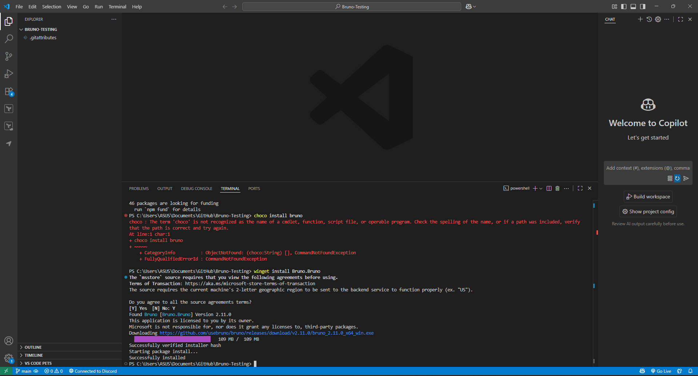

# API Debugging with Bruno

## Install Bruno Packaging



## Test the public endpoints


## Send custom headers


## Testing “protected” route

```tsx
import { Controller, Get, Headers, UnauthorizedException } from '@nestjs/common';

@Controller('protected')
export class ProtectedController {
  @Get()
  getProtected(@Headers('authorization') auth?: string) {
    if (!auth?.toLowerCase().startsWith('bearer ')) {
      throw new UnauthorizedException('Missing or invalid Authorization header');
    }
    return { ok: true, youSent: auth };
  }
}

```

```tsx
import { Module } from '@nestjs/common';
import { PingController } from './ping.controller';
import { ProtectedController } from './protected.controller';

@Module({
  imports: [],
  controllers: [PingController, ProtectedController],
  providers: [],
})
export class AppModule {}

```

## No token scenario


## With token scenario


## Reflection

## 1) How Bruno assists in contrast to Postman or cURL

Bruno is an offline-first, offline-capable API client that saves requests as text files inside a directory structure. Unlike Postman, Bruno does not suffer from cloud lock-in and enormous binary/JSON exports; your "collections" stay alongside source code and are nice in pull requests. Unlike cURL, Bruno provides you with reusable environments/tools/variables, clean sets, one-click invocation, and remains scriptable and CI-friendly (through its CLI). Overall effect: easy version control, speedy local development, high-quality reproducible API tests tightly coupled with your repo.

## 2) Authentication of a request in Bruno

Use variables and an Authorization header:

```
# Bruno-style request (example)
meta {
  name: Get Current User
  type: http
}
request {
  method: GET
  url: {{base_url}}/users/me
  headers {
    Authorization: Bearer {{access_token}}
    Content-Type: application/json
  }
}

```

Then set `base_url` and `access_token` for your environment (e.g., dev).

For login workflows, include a standalone request (e.g., **Auth → Login**) that posts credentials and stores the received JWT to `access_token`, then re-runs protected requests.

## 3) Benefits of grouping requests into collections

- **Versionable docs:** Sets are dynamic API docs for your repository; diffs pin-point exactly what was changed.
- **Reusability & DRY:** Environment variables (base URLs, tokens, IDs) allow requests to be reused across dev/test/prod.
- **Onboarding velocity:** New team members can execute end-to-end flows immediately without having to rewrite cURL commands.
- **Repeatable workflows:** Saved sequences (Auth → Create → Read → Update → Delete) eliminate human error.
- **CI hooks:** With a CLI, critical smoke tests can run in pipelines for quick regressions checks.

## 4) Structuring a Bruno collection for a NestJS application

**Goals:** mirror your NestJS modules, environments split, auth in the middle, and support happy-path and error-path tests.

```
bruno/
  environments/
    dev/        # e.g., base_url, access_token, seed IDs, test emails
    test/
    staging/
    prod/
  shared/
    utils/      # a couple of shared snippets or notes
  Auth/
    01-login (POST /auth/login)           # stores JWT -> {{access_token}}
    02-refresh (POST /auth/refresh)       # renews {{access_token}}
    03-profile (GET /auth/profile)
  Users/
    01-create (POST /users)
    02-get-by-id (GET /users/{{user_id}})
    03-list (GET /users?page={{page}})
    04-update (PATCH /users/{{user_id}})
    05-delete (DELETE /users/{{user_id}})
    errors/
      01-create-duplicate-email
      02-get-not-found
  Roles/
    01-assign (POST /roles/assign)
    02-guarded-admin-only (GET /admin/metrics)
  Items/
    # To map each NestJS module to a folder
    01-create
    02-get
    03-update
    04-delete
  Health/
    ping (GET /health)
    readiness (GET /health/readiness)
  CI/
    smoke-login-and-protected-route
    create-and-delete-user

```

**Environment variables (per env):**

- `base_url`: `http://localhost:3000` (dev), staging/prod hosts accordingly
- `access_token`: set by `Auth/01-login`
- `user_id`, `item_id`: populated dynamically after create requests (copy/paste or tiny script if you use them)
- `admin_email`, `admin_password`, `test_email`, `test_password`, `page`

**Request conventions:**

- Always use `Authorization: Bearer {{access_token}}` in secure directories (Users, Roles, Items).
- Don’t omit `errors/` subdirectories with negative tests (validation, forbidden, not-found) to protect your NestJS pipes/guards.
- Add a `Health/` directory to rapidly test `GET /health` and `GET /health/readiness` for solo dev and CI.

**Recommended workflows:**

- **Auth bootstrap:** run `Auth/01-login` to fill in `{{access_token}}`, then run any protected request.
- **CRUD flow per module:** `create → get → list → update → delete` (store the created ID to a variable before moving on).
- **Role guard check:** After non-admin login, run `Roles/02-guarded-admin-only` (should return 403); then admin login and assert 200.

**CI smoke tests (CLI):**

- A minimal pipeline can run `CI/smoke-login-and-protected-route` against staging nightly to catch broken auth or routing.
- Make smoke requests auto-cleaning or idempotent so they can remain safe for common areas.