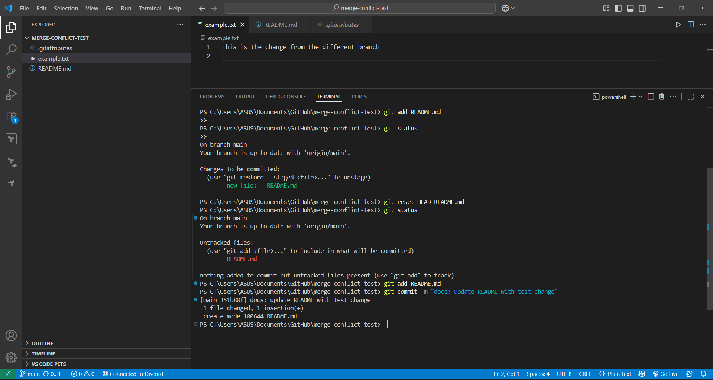

# Git concept: staging vs committing

## Experiment with Git command by modify the [README.md](http://README.md)



**Experiment Steps**

**Staged the file**

```bash
The command git add README.md was executed.
git status

```

The `README.md` file appeared in the *Changes to be committed* (staged area) section of the output.

---

**Unstaged the file**

```bash
The command git reset HEAD README.md was executed.
git status

```

The `README.md` file appeared as an *Untracked file* (no longer staged) in the output.

---

**Staged & committed the file**

```bash
The command git add README.md was executed.
The command git commit -m "docs: update README with test change" was executed.

```

The output confirmed that one file had changed and one insertion had been made `(+)`.

## Reflections

**What is the difference between staging and committing?**

When you stage your file changes you choose particular modifications which will be included in the upcoming commit. The staged modifications enter Git’s index which also operates under the name staging area. Running `git add <file>` puts the file into this area.

The process of committing saves all staged modifications into the repository history through new snapshots which receive both a message and a SHA identification number. This is done with `git commit -m "<message>"`.

---

**Why does Git separate these two steps?**

Granular control – You can pick only certain changes to commit and leave others unstaged.

Logical commits – Lets you group related changes together so each commit has a clear purpose.

Review before commit – You can check exactly what’s staged before finalizing it.

Flexibility – You can stage changes over time and commit them all when ready.

Error prevention – Reduces the chance of accidentally committing unwanted edits.

---

**When would you want to stage changes without committing?**

Work in progress – You want to save progress in the staging area but aren’t ready to finalize it.

Preparing multiple commits – You might stage certain related edits now, commit them later, and keep unrelated changes separate.

Partial commits – You might stage only part of a file’s changes to keep commits focused.

Review purposes – To preview what will be committed before actually creating the commit.