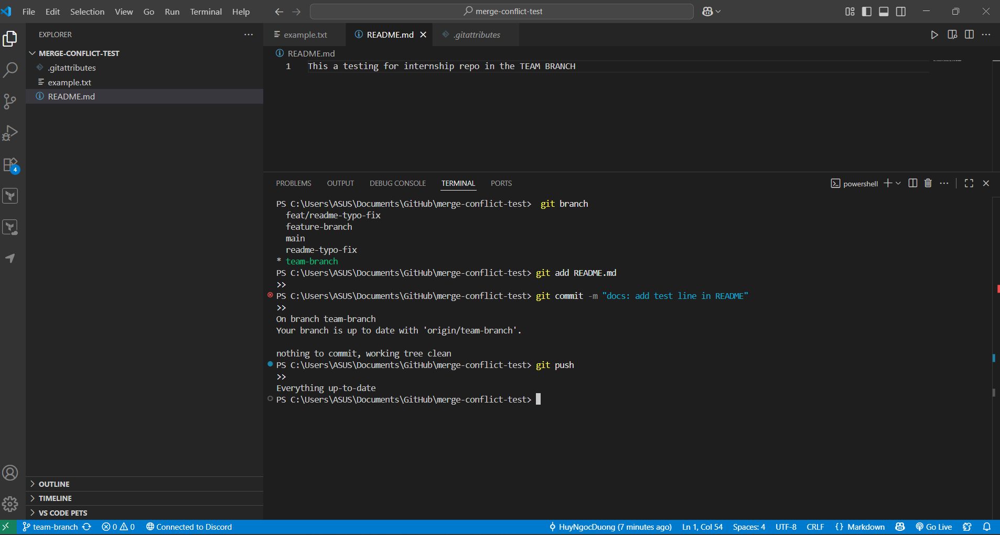

# Branching & Team Collaboration

## Create a new branch, make a small change and commit to the new branch

I used git branch to locate the current branch I’m using then add a README file with a different line compare to the main branch, then commit it and push to GitHub.

## Switch back to main to see the difference

As you can see here, when i change to main using the command `git checkout main` it changed to main branch and the [`README.md`](http://README.md) file in main is different.

## Reflections

**Why is pushing directly to main problematic?**

The deployment of untested or incomplete code to main branch results in immediate bugs appearing in production.

The direct push method skips the pull request (PR) review process so security issues and mistakes remain undetected.

The combination of multiple developer changes into main makes it challenging to determine which specific commit caused a bug.

The practice of pushing code directly to main creates merge conflicts that disrupt both development and deployment processes.

---

**Branches serve as a tool to facilitate code review through what mechanism?**

The feature development process on branches enables developers to work independently from the main branch.

The Pull Request (PR) workflow enables you to create a PR from your branch to main which allows teammates to review the code before merging.

The CI/CD pipelines execute automated testing on the branch before the merge process to detect problems at an early stage.

The use of branches maintains a clean main branch while maintaining detailed records of feature development and PR discussions.

---

**When two developers modify the same file through different branches what occurs?**

Possible merge conflicts – When merging one branch into another, Git will try to automatically combine changes. Git fails to determine which version to maintain when two branches modify identical lines thus it creates a merge conflict.

The developer who performs the merge needs to manually inspect conflicting parts of the file before selecting the appropriate version or merging both versions and then making a new commit of the resolved file.

When changes occur in different parts of the file Git successfully merges them automatically without any problems.