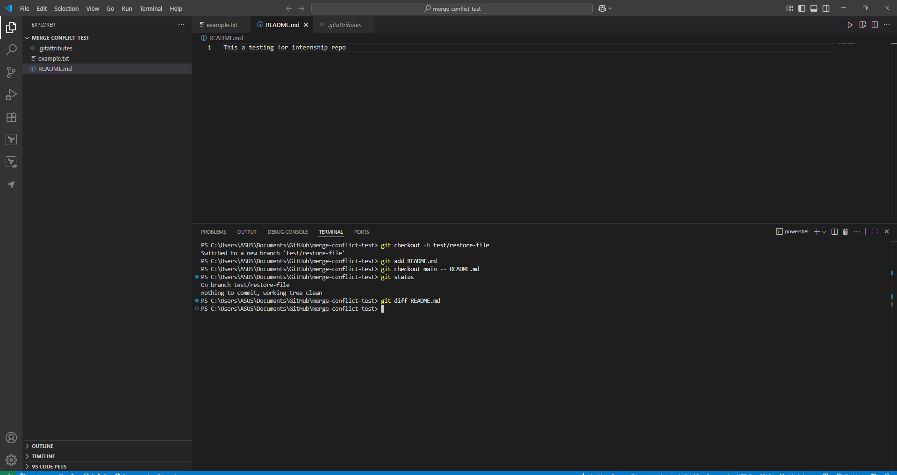

# Advanced Git Commands & When to Use Them

## Experiment with Git comamnds

### `git checkout main -- <file>` (restore a file from main branch)

### `git cherry-pick <commit>` (apply one specific commit)

### `git log` (view commit history)

### `git blame <file>` (who changed which line)

## Reflections

**What does each command do?**

This command retrieves the main branch version of a selected file in the current branch without affecting any other files or switching to a different branch.

Think of it as: “Give me the version of this one file from main.”

The modern equivalent for this command is `git restore --source=main -- <file>`

**git cherry-pick <commit>**

This command applies the changes from a single commit to your current branch through a replay of that commit.

This action functions as a single change transfer between branches which excludes entire branch integration.

**git log**

The command shows commit history along with additional features that enable graph and patch visualization and file and author and message filtering.

Think of it as: “Show me how we got here.”

**git blame <file>**

The command reveals each line of file contents along with the SHA hash of the last modification and the author and timestamp.

Think of it as: “Who last changed this line, and when?”

---

**Where would you use this command in a real-world project?**

The `git checkout main` command can retrieve specific files from the main branch by using either `git checkout main -- <file>` or `git restore --source=main -- <file>`.

Hotfix triage situations arise when you perform risky changes to a single file and need to recover only that file from the main branch version.

The command helps you return a file to its main version to eliminate formatting differences that appeared after accidental changes.

**git cherry-pick <commit>**

The production hotfix scenario requires applying a critical fix from a release branch to main or main to the release branch while ignoring unrelated work.

Backporting: Apply a specific fix to older supported branches.

Selective adoption: Pull in one contributor’s commit without taking experimental commits that sit around it.

**git log**

Regressions need debugging because it helps users determine the exact time behavior changed and which commit made the modification.

The analysis of messages helps you build a changelog.

Code archaeology: Understand context and rationale before refactoring.

**git blame <file>**

Ownership & context: Identify who to ask about a tricky line and why it exists.

Root-cause: See exactly when a line changed to correlate with a bug report.

Audit: Track sensitive logic changes (auth, payments, security checks).

---

**What surprised me while testing these commands?**

**Cherry-pick can be “empty.”**

When I performed the command `git cherry-pick 5f46819` Git displayed an empty result. This situation occurs when the target branch contains identical modifications which might stem from previous merges or cherry-picks or manual reimplementation. You can resolve this issue by executing `git cherry-pick --skip` followed by creating a fresh commit if necessary for cherry-picking.

**The command git blame -L requires sufficient line numbers.**

The command `git blame -L 10,40 README.md` produced an error because the README.md file contained only one line of text. The logic becomes clear after reviewing the command since a range must be present.

**The command git checkout main -- <file> performs precise operations.**

The command operates only on the designated file without modifying any other staged modifications. The tool provides a useful feature to revert specific files while maintaining the entire working state intact.

**The output of git log becomes significantly more potent when users enable additional flags.**

The combination of git log flags `--oneline --graph --decorate --all` creates a compact branch topology view which works best for long-running multi-dev repositories.