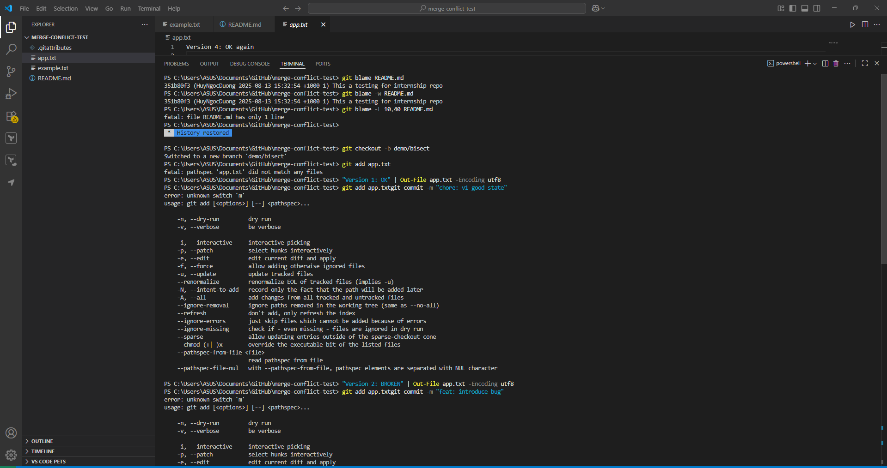

# Understand git bisect

## Create a test scenario




### **ensure on a throwaway branch**

git checkout -b demo/bisect

### **Commit 1: good**

"Version 1: OK" | Out-File app.txt -Encoding utf8
git add app.txt
git commit -m "chore: v1 good state"

### **Commit 2: introduce a bug**

"Version 2: BROKEN" | Out-File app.txt -Encoding utf8
git add app.txt
git commit -m "feat: introduce bug"

### Commit 3: still broken

"Version 3: still BROKEN" | Out-File app.txt -Encoding utf8
git add app.txt
git commit -m "feat: more changes (bug persists)"

### Commit 4: fix the bug

"Version 4: OK again" | Out-File app.txt -Encoding utf8
git add app.txt
git commit -m "fix: remove bug"

### Note the good baseline SHA (first commit)

git log --oneline -4

## Use git bisect to track down the commit that introduced the issue


## Reflections

1. **What git bisect Does**
    
    The Git version control system includes a built-in binary search tool named `git bisect` which helps developers locate the exact commit where bugs or regressions started.
    
    The tool operates through the following steps:
    
- You need to identify a “good” commit without bugs and a “bad” commit with bugs to Git.
- The system retrieves the commit which stands at the middle point of the two commits.
- You verify the midpoint commit to Git before indicating whether it passes or fails the test.
- The tool reduces the search area by half in each step until it locates the initial bad commit.

---

1. **When to Use It in Real-World Debugging**
    
    The following situations require the use of `git bisect`:
    
- The bug has manifested but you cannot determine its exact introduction time.
- The bug remains consistent (you can verify if a commit contains the bug or not).
- The repository contains numerous commits between the last known good state and the first known bad state which makes manual review both time-consuming and error-prone.
- The project involves multiple developers who need help identifying responsible code contributors through non-guessing methods.

**Example:**

A web application project spanning hundreds of commits during months shows a feature that has ceased functioning. You choose to use:

```bash
git bisect start
git bisect bad <SHA_of_bug_commit>
git bisect good <SHA_of_good_commit>

```

You will need to test only a few commits before identifying the problematic commit.

---

1. **How It Compares to Manually Reviewing Commits**

| **Method** | **Pros** | **Cons** |
| --- | --- | --- |
| **git bisect** | - Very fast (binary search cuts search space in half each time)  - Systematic and reliable  - Works even in long commit histories | - Requires a reproducible test case  - Still needs manual “good”/“bad” marking |
| **Manual Review** | - Can work for small commit histories  - Allows reading commit messages for context | - Slow for large histories  - Easy to miss the actual bug commit  - Depends on accurate commit messages |