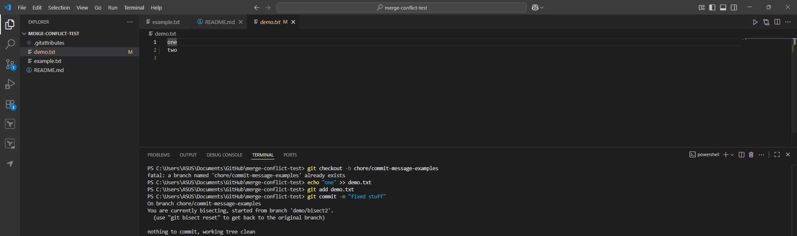

# Writing Meaningful Commit Messages

## **Make three commits in my repo with different commit message styles**

### First message:



### Second message:


### Third message:


## **Explore commit histories in an open-source GitHub project** (e.g., [React](https://github.com/facebook/react), [Node.js](https://github.com/nodejs/node)) and analyze good vs. bad commit messages.

1. Vague commit message (bad)

The commit message reads “Update README.md.”

Link: [https://github.com/nodejs/node-inspect/commit/9043c69](https://github.com/nodejs/node-inspect/commit/9043c69)

The commit message lacks essential details about changes and their reasons so users need to view the diff to understand anything.

Rewrite (better): docs(readme): remove outdated Chrome DevTools link (or whatever actually changed).

1. Overly detailed subject (not great)

The commit message “DevTools Avoid uncached Promise when symbolicating sources in environments without file fetching (#34224)” appears at [https://github.com/facebook/react/commit/01ed0e96427328780c8da4caa93377eb9746ff08](https://github.com/facebook/react/commit/01ed0e96427328780c8da4caa93377eb9746ff08).

The subject contains excessive conditions which makes it hard to scan; a more concise subject combined with detailed explanations in the body would improve readability.

Rewrite (tighter): devtools: avoid uncached Promise during source symbolication

The body section should explain both the “no file fetching” environment and the behavioral change.

1. Well-structured commit (good)

The commit message “src: fix HTTP2 mem leak on premature close and ERR_PROTO” appears at [https://github.com/nodejs/node/commit/6cc8d58e6f](https://github.com/nodejs/node/commit/6cc8d58e6f).

The commit message includes three beneficial elements: it specifies the scope (src), describes the exact issue (“HTTP2 mem leak…”), and provides complete details through references (CVE), tests and context. The commit allows simple triage operations and automatic changelog generation. show here and dont change anything

## Reflections

1) A good commit message contains specific elements

- A subject should be brief yet clear in the imperative mood while keeping it under ~50 characters and within the 72-character limit.
    
    Example: fix(login): handle null session token
    
- A body section with additional context provides optional information about change requirements and solution approaches and documented side effects and alternative solutions.
- The convention must remain constant to enable both human readers and tooling systems to parse the messages.
- References when relevant: Issue/PR IDs, tickets, links to design docs.
- Call out breaking changes: BREAKING CHANGE: with migration notes.

Template you can copy:

```
<type>(<optional scope>): <short summary>

Why:
- <Problem or motivation>

What changed / How:
- <Approach, key details, side effects>

Refs: #123, PR #456
BREAKING CHANGE: <if any>

```

2) A well-structured commit message enables teams to collaborate more effectively through what specific benefits?

- The review process becomes more efficient because readers can understand intentions by studying the diff without extensive searching.
- The knowledge transfer process becomes easier because new team members can understand the historical decisions and reasoning behind the code from examining the commit log.
- The ability to scan through Git blame and history allows you to identify line changes and determine safety for reverting modifications.
- The automation of release notes and changelogs becomes possible through established conventions which enable identification of changes from the last tag version.
- Product and QA teams benefit from traceability because tickets and tests provide acceptance criteria and test impact information.

3) Poor commit messages create problems which emerge during later stages of development.

- Teammates experience time waste and confusion because of ambiguous notes which force them to inspect diffs to understand the intended purpose.
- The absence of context when reverting code may result in reintroducing bugs and breaking dependencies.
- The inability to identify between bug fixes and experimental code hinders debugging efforts.
- The inconsistency in message formats creates problems for automated release tooling and changelog generation as well as metrics systems.
- Some organizations need audit trails which require documentation of what was done together with reasons and responsible personnel. Weak messages fail audits.

4) Quick DO / DON’T

- **DO:** feat(cart): show shipping ETA on checkout
    
    Body: why customers need it, how computed, perf notes, tests added, Refs #321.
    
- Update and misc fixes along with temporary changes should not be included as they both use incorrect subject lines that combine multiple explanations into one line.