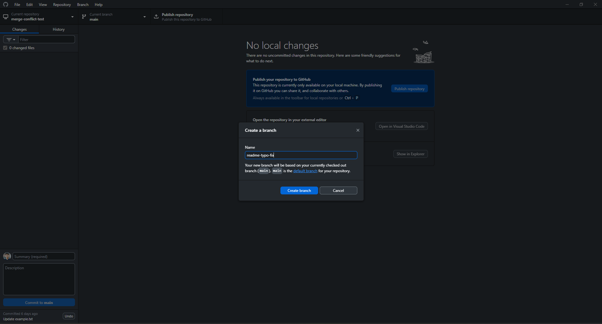

# Creating & Reviewing Pull Requests

## What is a Pull Request (PR)?

The Pull Request (PR) exists as a Git-based platform feature (GitHub, GitLab, Bitbucket) which enables developers to suggest modifications from feature branches into main or develop branches.

The formal request enables code review before merging changes through this platform which provides space for modification discussions and code review and quality assurance.

## Why it’s used

Code Review & Quality Control – Team members can review each other's work through PRs before merging to detect bugs while upholding coding standards and best practices.

The discussion thread within PRs enables developers to explain their modifications while asking questions and receiving feedback which enhances team coordination.

Version Control Safety – The branch-based system allows controlled merging of changes which protects the main codebase from damage.

PRs function as a record system which stores both context and rationale and conversation about changes for future reference.

Automated Checks – CI/CD pipelines execute tests and security scans and linting automatically during PR opening to detect problems at an early stage.

## **Create a new branch in your Git desktop client.**

I create a branch named **readme-typo-fix** 

## Make a small change and push the branch to Github

I used the terminal command to push the branch to GitHub

## Set the PR Base & Compare Branch

## Create a PR Title and Description (Dont have a issue link since this is an example)

## **Review an existing PR in a public open-source repo**

**Open-Source PR Review Summary**

**PR Title:** [DevTools] Use Visually Lighter Skeletons

**Author:** sebmarkbage

**Repository:** facebook/react

**PR Link:** [https://github.com/facebook/react/pull/34185](https://github.com/facebook/react/pull/34185)

---

**Context**

The PR modifies the loading skeleton visuals in React DevTools to make them less visually heavy and distracting during content loading.

---

**Observations**

The author clearly describes the present issue which involves heavy and distracting skeletons.

**Proposed solution:**

- The loading skeletons begin as nearly invisible elements before they gradually fade into view.
- The visual weight of the content remains consistent with the final result to prevent disturbing visual effects.
- The PR included a necessary addition of a stack trace skeleton.
- The disabled button behavior received an updated design to become less noticeable.
- Multiple commits with descriptive messages such as "Make the skeleton start at blank and fade into dimmest" and "Add missing Suspense boundary since the StackTraces can now suspend" were implemented.

**Review process:**

- A reviewer (eps1lon) was requested.
- All automated checks (241) succeeded in their execution.
- The PR contains no conflicts with the base branch during merge operations.

---

**What I Learned**

- The author provided detailed information about the problem and design goals and approach which made the review process more efficient.
- The review process became easier because each commit focused on a particular aspect of the change which allowed for easier reversal if needed.
- The PRs include UI/UX considerations through rationalized small visual changes which reduces the chance of misinterpretation.
- The merge process becomes faster because the PR passes all CI checks and avoids conflicts.
- The process of requesting reviews before merging helps maintain high-profile open-source repository coding standards and ensures quality.

## Reflections

**The team workflow heavily depends on PRs because of what reasons?**

Quality control – The process of reviewing code before merging helps developers discover errors and maintain coding standards which enhances the quality of the entire codebase.

The discussion platform provides developers an opportunity to explain their modifications while seeking input from others and distributing feedback.

The system enables tracking of changes through the documentation of change reasons alongside discussion histories and commit associations for straightforward evaluation of previous choices.

The process of controlled change integration reduces the probability of introducing disruptive changes to the main branch.

The automation hooks enable CI/CD pipelines to execute testing procedures along with checks automatically for every pull request before the merge process.

---

**What makes a well-structured PR?**

The PR title must follow type(scope): summary convention (e.g., fix(auth): handle expired token).

A PR should handle either one logical feature implementation or one logical code modification.

The description should include explanations about the problem and solution and the selection process behind the chosen approach.

The use of specific keywords such as Fixes #123 enables automatic closure of linked issues when the merge occurs.

The evidence includes updated tests together with relevant screenshots or logs that support the submission.

The code style of the project and all CI checks must pass before submitting the PR.

The review process becomes faster when all unrelated changes are excluded from the review.

---

**What I learned from reviewing an open-source PR**

I gained knowledge from examining the React repository's [DevTools] Use Visually Lighter Skeletons change through this process.

The review process became more efficient because the author clearly explained the problem statement and provided goals and solution details.

Small commits help – Each commit addressed a single aspect of the change, making it easier to follow and revert if needed.

UI/UX changes need reasoning – Even small visual adjustments were justified to avoid misunderstandings.

The combination of passing CI checks with no merge conflicts accelerated the approval process for the PR.

The author obtained review feedback from maintainers in the high-profile repository before making the merge request.

## **Request feedback on your PR from a peer**

## **Merge the PR (if approved) and delete the branch**

