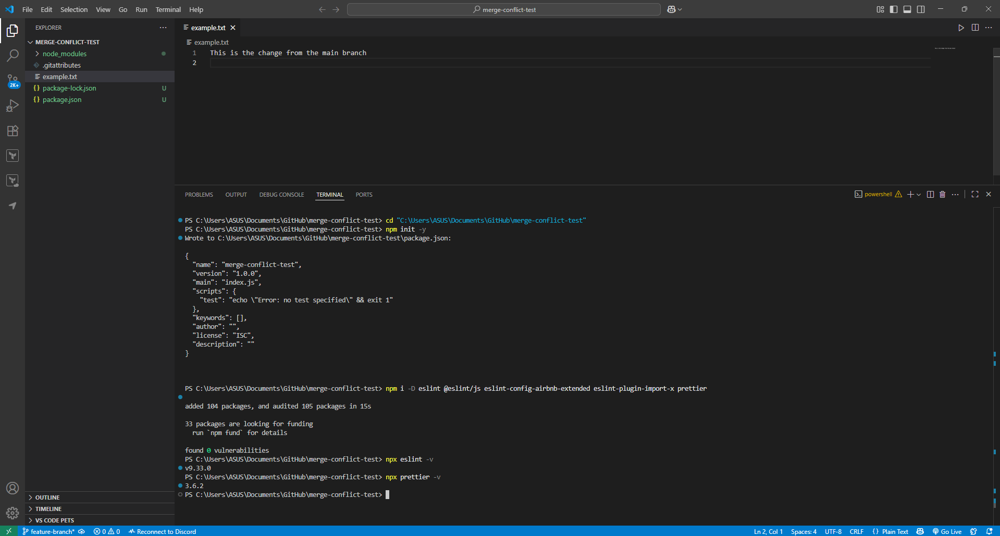

# Code Formatting & Style Guides

## **Install and configure ESLint and Prettier**



## **Review the Airbnb javascript style guide.**

### Philosophy (why this guide)

- Airbnb codifies “a mostly reasonable approach to JavaScript”: consistent, predictable code that’s easy to review and maintain across teams.
- The official guide lives on **GitHub** and **airbnb.io**.

### Core rules to internalize

- **Variables & scope**
    - Use `const` by default; use `let` only when reassignment is required.
    - Never `var` (block scope > function scope).
    - Source: airbnb.io
- **Objects & arrays**
    - Prefer literals: `{}` and `[]`.
    - Use computed property names when keys are dynamic.
    - Use array methods (`map`, `filter`, `reduce`) and `push` instead of manual index writes.
    - Prefer spread `[...]` to copy.
    - Source: airbnb.io
- **Destructuring**
    - Destructure objects/arrays to pull out fields instead of accessing `obj.foo` repeatedly.
    - It documents intent and reduces boilerplate.
    - Source: GitHub
- **Strings**
    - Use single quotes.
    - Use template literals for interpolation and multi-line strings.
    - Source: GitHub
- **Functions & arrows**
    - Use function declarations or arrow functions.
    - Keep arrow bodies concise and prefer implicit returns when there’s no side effect.
    - Put default parameter values last.
    - Avoid mutating parameters.
    - Source: GitHub
- **Classes**
    - Use ES6 classes.
    - Prefer methods over assigning functions to a prototype.
    - Use `extends` for inheritance.
    - Source: GitHub
- **Modules**
    - Always use ES modules: `import` / `export`.
    - Prefer named exports.
    - Avoid wildcard imports.
    - Keep one default export if you use it.
    - Enforce tidy, resolvable imports.
    - Sources: GitHub, DeepWiki
- **Iterators**
    - Use array higher-order methods instead of `for…in`/`for…of`/manual iterators.
    - They produce clearer and more immutable code.
    - Source: airbnb.io
- **Equality & conditionals**
    - Use strict equality `===`/`!==`.
    - Treat truthy/falsy carefully.
    - Be explicit in conditions.
    - Source: GitHub
- **Semicolons, commas, whitespace**
    - Semicolons: yes. Avoid relying on ASI.
    - Use trailing commas in multi-line lists/objects to get cleaner diffs.
    - Enforce consistent spacing/indentation for readability.
    - Sources: BookStack, GitHub
- **Naming & style**
    - `camelCase` for variables/functions.
    - `PascalCase` for classes.
    - Acronyms are treated like words (e.g., `HttpRequest`, not `HTTPRequest`).
    - Do not prefix underscored “privates”; use module scope or class fields instead.
    - Source: GitHub
- **Comments**
    - Use `//` for single-line.
    - Use `/** … */` JSDoc where it adds value.
    - Comment the “why,” not the “what.”
    - Source: GitHub

### What this means for your project (practical checklist)

- Install ESLint + an Airbnb ruleset and Prettier; let Prettier handle formatting and ESLint handle correctness/best-practices.
- Convert `var` → `const`/`let`.
- Replace loops with `map`/`filter` where appropriate.
- Standardize on single quotes, semicolons, trailing commas.
- Use `import`/`export` consistently and clean up import order/duplicates.

## **Run the formatter and linter on your codebase and fix any issues.**


## Reflections

### 1. Why is code formatting important?

Consistency – makes the code look the same no matter who wrote it. This reduces friction in teams and avoids “style wars.”

The readability of code improves when it is properly indented and spaced and aligned because this makes it easier for humans to scan and debug and maintain the code.

Error prevention – clear formatting highlights missing braces, stray semicolons, or inconsistent indentation that can hide bugs.

The integration of tools enables automatic standard enforcement through the combination of Prettier formatters with ESLint linters which work with editors and CI pipelines.

---

### 2. What issues did the linter detect?

From your screenshot, ESLint flagged a parsing error due to encoding (Unexpected character '�'). Once that was fixed, a typical linter would also catch things like:

- Missing or inconsistent semicolons
- Extra or missing spaces (e.g., `const x=1` → `const x = 1;`)
- Potential errors (like unused variables, undeclared variables, etc.) depending on your rules.

For your `test.js`, it would likely suggest:

```jsx
const x = 1;
console.log(x);

```

instead of

```jsx
const x=1
console.log(x)

```

---

### 3. The process of code formatting resulted in improved readability of the code.

Yes ✅

Before formatting:

```jsx
const x=1
console.log(x)

```

After formatting:

```jsx
const x = 1;
console.log(x);

```

Variables and operators are clearly separated.

The semicolons used throughout this code prevent potential JavaScript pitfalls from happening.

The file structure becomes visible through both indentation and spacing regardless of the file size.