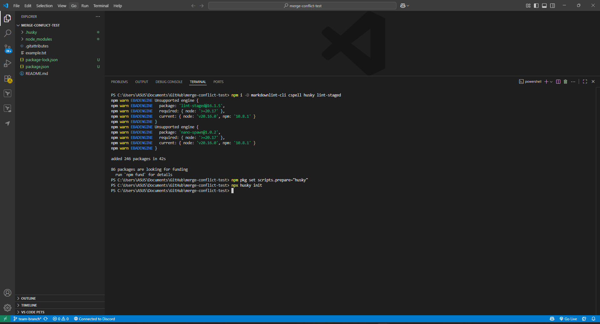

# Static Analysis Checks in CI/CD

## **Set up a CI workflow that runs Markdown linting and spell checks on PRs in your repo.**

### Install tools



### Add configs and npm scripts

## `package.json`

```json
{
  "scripts": {
    "docs:lint": "markdownlint \"**/*.md\" --ignore node_modules",
    "docs:spell": "cspell \"**/*\" --config cspell.json --no-must-find-files --no-progress",
    "test:docs": "npm run docs:lint && npm run docs:spell"
  },
  "lint-staged": {
    "*.{md,mdx}": [
      "markdownlint --fix",
      "cspell --no-progress --no-must-find-files"
    ]
  }
}

```

## `.markdownlint.json`

```json
{
  "default": true,
  "MD013": false,                     // line length (allow long lines)
  "MD033": { "allowed_elements": [] },// allow inline HTML if needed; fill if you use <br>, , etc.
  "MD041": false                      // no need for top-level heading in small docs
}

```

## `cspell.json`

```json
{
  "$schema": "https://raw.githubusercontent.com/streetsidesoftware/cspell/main/cspell.schema.json",
  "version": "0.2",
  "language": "en-AU",
  "ignorePaths": [
    "node_modules",
    "dist",
    "build",
    ".git",
    ".github",
    "package-lock.json"
  ],
  "files": ["**/*.md"],
  "dictionaries": ["softwareTerms", "en-AU"],
  "words": [
    "Swinburne",
    "phpMyAdmin",
    "Husky",
    "markdownlint",
    "cspell",
    "repo",
    "CI/CD",
    "DRY"
  ]
}

```

## Add Husky pre-commit hook (with lint-staged)

Husky created `.husky/` and a default `pre-commit`. Replace its content with:

## `.husky/pre-commit`

```bash
#!/usr/bin/env sh
. "$(dirname -- "$0")/_/husky.sh"

echo "🔎 Running Markdown lint + spell check on staged files..."
npx lint-staged

```

(Optional) Add a **pre-push** hook to run full docs checks:

## `.husky/pre-push`

```bash
#!/usr/bin/env sh
. "$(dirname -- "$0")/_/husky.sh"

echo "🧪 Running full docs quality checks before push..."
npm run test:docs

```

Make sure hooks are executable (mostly needed on non-Windows):

```bash
chmod +x .husky/pre-commit .husky/pre-push

```

---

# 4) GitHub Actions: run checks on PRs

Create the workflow file:

## `.github/workflows/docs-quality.yml`

```yaml
name: Docs Quality

on:
  pull_request:
    branches: [ "**" ]
    # Optional: only run when docs change
    # paths:
    #   - "**/*.md"
  push:
    branches: [ main ]  # keep main clean

jobs:
  docs:
    runs-on: ubuntu-latest

    steps:
      - name: Checkout
        uses: actions/checkout@v4

      - name: Setup Node
        uses: actions/setup-node@v4
        with:
          node-version: "20"

      - name: Install deps (ci)
        run: npm ci

      - name: Markdown lint
        run: npm run docs:lint

      - name: Spell check
        run: npm run docs:spell

```

---

# 5) Create a quick test & open a PR

Create a small Markdown file with an intentional lint + spelling issue:

## `docs/test.md`

```markdown
# Quick Demo

This sentense has a speling errror and veryyyyy loooooooooooooong line to test MD013 if you enable it (we disabled it).

-bad list style (missing space)

```

Now commit on a feature branch and push:

```bash
git checkout -b chore/docs-ci
git add .
git commit -m "ci(docs): add markdownlint + cspell with husky hooks"
git push -u origin chore/docs-ci

```

Open a Pull Request on GitHub:

- Title: `ci(docs): add Markdown lint + spell checks`
- The **Docs Quality** workflow should run automatically.
- Fix issues locally (the pre-commit hook will guide you), commit, and push updates; the PR checks will re-run.

## Reflections

**What is the purpose of CI/CD?**

- The main goal of Continuous Integration (CI) is to run automated builds and tests for every modification to catch problems early on while keeping the main branch releasable and giving fast feedback.
- Continuous Delivery/Deployment (CD): Automate packaging, releases, and (optionally) production deploys so shipping is repeatable, low-risk, and frequent.
- Core outcomes: Faster cycle time, fewer regressions, reproducible builds, clear release traceability, and better team visibility.

**The implementation of automated style checks leads to what improvements in project quality?**

- Consistency: Enforces one formatting/spelling/style, reducing review noise.
- The quality control process of shift-left quality detects typos and lint errors before human reviewers examine the code.
- The onboarding process instructs new contributors about conventions by showing them failed CI attempts instead of requiring them to learn through trial and error.
- Signal-to-noise: PR diffs focus on logic, not whitespace or punctuation.
- The following documents are reliable because Markdown lint and spell check functions maintain documents both clear and searchable.

**Challenges with enforcing checks in CI/CD**

- False positives & tuning: Linters/spellcheckers can be noisy; requires curated dictionaries and rule configs.
- Developer friction: Slow or flaky pipelines encourage bypasses; pre-commit hooks help but can annoy if heavy.
- Flakiness: Unstable tests or network-bound steps erode trust in CI.
- Performance & cost: Matrix builds, large monorepos, or e2e suites can be slow/expensive without caching/sharding.
- The environment drift between local, CI, and prod (Node/PHP versions, locales) leads to “works on my machine.”
- The system becomes more complex because of Governance features which include Secrets, permissions, required checks and branch protections.

**The main differences between CI/CD pipelines exist between small projects and large teams.**

- **Small projects**
    - The pipeline shape consists of 1–3 fast jobs which start with lint followed by unit tests and then build. Often a single workflow.
    - Checks: Pre-commit hooks for style; CI re-runs the same quickly.
    - Deploy: Auto-deploy on main or manual trigger; minimal approvals.
    - Infra: Simple runners; minimal caching and artifacts.
- **Large teams**
    - The pipeline consists of multiple stages which start with lint/typecheck followed by unit then integration and e2e and security and package and deploy.
    - Scale tactics: Test sharding/parallelism, dependency caching, build artifacts, Docker image promotion.
    - Quality gates: Required checks, coverage thresholds, SAST/DAST, license scanning, change-approval policies.
    - The deployment process starts with dev followed by staging and canary before reaching production. The system uses feature flags and automated rollbacks and progressive delivery methods.
    - Governance: Protected branches, code owners, audit trails, secrets management, environment-specific policies.

**Practical tips (applies to both)**

- The project needs local fast checks through Husky and lint-staged and CI should run the complete suite of tests.
- Pin tool versions and cache dependencies to cut flakiness/time.
- The style/lint blocking should be made blocking while link check or heavy scans should be made informational first.
- The system requires ongoing maintenance of rules and dictionaries to maintain high signal quality and low friction levels.