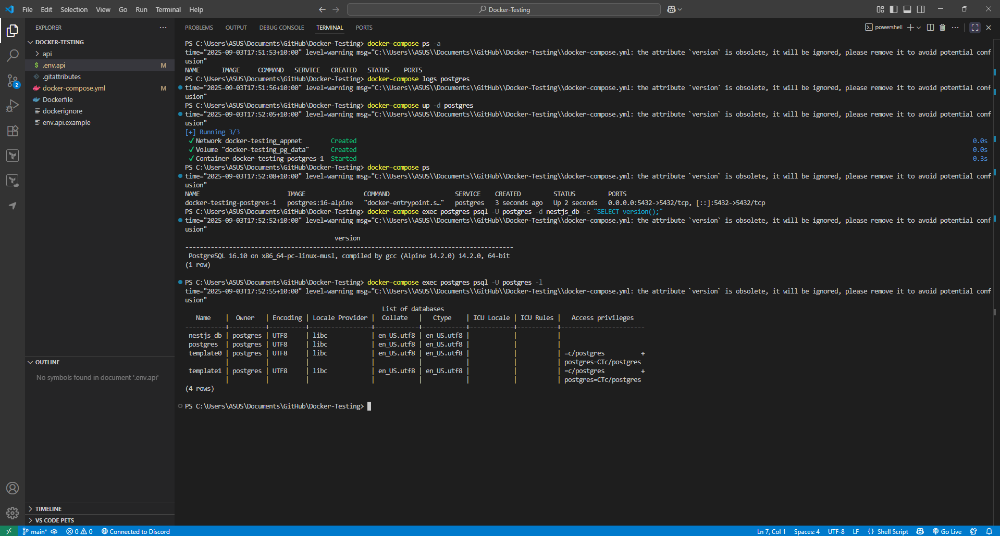

# Using Docker for NestJS Development

## Add DockerFile and Docker-compose.yml to the project root to run

## Steps to create a DockerFile in NestJs

### **Step 1: Create the `Dockerfile` and a `.dockerignore` file**

First, create a `Dockerfile` in the root directory of your NestJS project. A `Dockerfile` is a text file that contains a series of instructions for building a Docker image.

It is also considered a best practice to create a `.dockerignore` file. This file functions similarly to a `.gitignore` file and tells Docker to exclude unnecessary files and directories, such as `node_modules` and `.git`, from the Docker image. This helps reduce the final image size and improves security.

### **Step 2: Choose a Base Image**

Use the `FROM` instruction to specify the base image for your application. A Node.js image is the standard choice. For better performance and a smaller final image size, it is recommended to use a lightweight variant like `node:20-alpine`.

`FROM node:20-alpine`

### **Step 3: Set up the Working Directory**

The `WORKDIR` instruction creates a dedicated directory inside the container and sets it as the working directory for all subsequent commands.

`WORKDIR /usr/src/app`

### **Step 4: Copy and Install Dependencies**

This is a critical step for build performance. To leverage Docker's build cache, you should copy only the dependency declaration files first (`package.json` and `package-lock.json` or `yarn.lock`). Then, install the dependencies. Using `npm ci` is more reliable in automated environments like Docker builds than `npm install`.

`COPY package*.json./RUN npm ci`

### **Step 5: Copy Application Code and Build for Production**

After dependencies are installed, copy the rest of your application's source code into the container. Then, run the build command to compile the TypeScript code into a production-ready JavaScript bundle.

`COPY..RUN npm run build`

### **Step 6: Expose a Port**

The `EXPOSE` instruction informs Docker that the container will listen on a specific port at runtime. This does not publish the port, but rather documents it.

`EXPOSE 3000`

### **Step 7: Define the Startup Command**

The final step is to use the `CMD` instruction to define the command that will be executed when the container starts. This command will run your compiled NestJS application.

`CMD ["node", "dist/main.js"]`

`Test PostgreSQL connection to nestjs_db and list all the avaliable database`

I will put the dockerfile and docker-compose.yml in the github comments

## Reflection

### **How a Dockerfile Specifies a Containerized NestJS Application**

A Dockerfile is a specification to create a Docker image. For a NestJS app, it is an array of instructions that specify the whole environment, starting from the base OS, down to the dependencies, and the application code.

The steps usually are:

- **Choosing a Base Image:** The `FROM` instruction specifies the base image to use as a basis for building the Docker image, e.g., a Node.js release like `node:18` or an efficient `node:20-alpine`.
- **Setting Up the Environment:** The `WORKDIR` command sets up a distinct directory inside the container for application code.
- **Installing Dependencies:** It performs a copy of the `package.json` file followed by a command like `npm install` or `npm ci` to install all Node.js packages that are required.
- **Copying Application Code:** The remaining source code is copied into the container.
- **Building for Production:** A command like `npm run build` is run to build the application from TypeScript to JavaScript.
- **Opening a Port:** The `EXPOSE` command tells Docker that the application will be listening for incoming requests on a particular port, such as port 3000.
- **Specifying the Startup Command:** The `CMD` command tells Docker what to run on startup when a container is launched, such as `node dist/main.js`.

### **The Use of a Multi-Stage Build**

The main purpose of multi-stage build is to produce a smaller, secure, and more efficient final image. It's an important best practice for production environments.

It does this by:

- **Segregating Environments:** The process of building is divided into separate stages, normally a "builder" stage and the ultimate "production" stage.
- **Removing Unused Files:** The "builder" phase includes all of the development dependencies and build tools necessary to build the application. The last "production" phase is a much smaller image that simply copies the necessary, compiled application code and production dependencies from the prior stage.
- **Reducing the size of the Image:** With the exclusion of the development-only files, the final image size is greatly reduced. This may be a significant reduction in size, often from well over 1GB to a tiny 15MB.
- **Enhancing Security:** The smaller image size equates to a smaller attack surface since it does not carry the additional libraries, compilers, or build utilities not required during runtime.

### **How Docker Compose Simplifies Running Multiple Services**

Docker Compose is an application that streamlines management of multi-container applications. All the services, networks, and volumes can be declared in one `docker-compose.yml` file rather than a series of complicated `docker run` commands.

Important streamlining is:

- **Service Definition:** It explicitly states each service (e.g., a NestJS application and a postgres database) and its setup.
- **Networking:** Docker Compose will automatically create one network and place all the services within it. That way, services will be able to communicate with one another by service names as hostnames (e.g., the NestJS application can connect to the database using hostname `postgres`).
- **Data Persistence:** It makes it easy to create and configure named volumes and ensure that data like the PostgreSQL database files remain even after the container is removed or re-created.
- **Dependency Management:** The `depends_on` command guarantees that services are launched in the proper sequence and the database container is completely started before the application container tries to use it.
- **Single-Command Orchestration:** A single command like `docker-compose up -d` can build, create, and start all services in the file in detached mode.

### **Exposing API Logs and Debugging a Running Container**

The terminal output shown in the image consists of multiple commands used for logging and debugging:

- **Logs Viewing:** `Docker-compose logs` can be used to see the combined output of all services. The `f` flag can be utilized to keep the logs updated in real time while debugging runtime errors.
- **Opening a Shell Inside a Running Container:** You can open a shell for a running container using the `docker-compose exec` command. The command `docker-compose exec postgres psql` in the image opens a `psql` shell inside the running `postgres` container to enable direct access to the database.
- **Manual Verification:** Once you are within a container shell, you can manually execute commands to test functionality, for instance, using `curl` to test whether an API endpoint is up. This serves to test that the service is running as it should from the inside out.