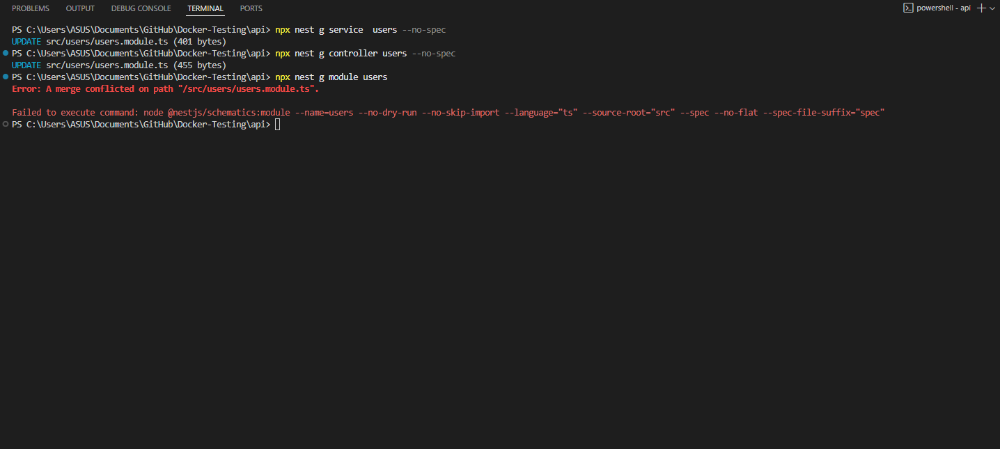

# Using NestJS CLI for Scaffolding

## **Generate a new controller, service, and module using the CLI**

## **Explore additional CLI commands like `nest generate` and `nest build`**

Some are conflict because i already did it before

## Reflection

1. How NestJS CLI Facilitates Easy Development

NestJS Command Line Interface (CLI) gives developers an efficient toolset to enable them to develop applications faster. Eliminating tasks that are repetitive in nature, such as project scaffolding, file generation, and build setup, the CLI keeps developers from performing manual coding work and reduces the occurrence of human error. It is also tightly coupled with TypeScript and newer build tools so that developers can write business logic instead of boilerplate configuration. In group settings, CLI makes sure the new functionality is structured in the same way to reduce learning time and optimize productivity.

1. Purpose of nest generate

The nest generate (or nest g) command is the focal point of CLI capabilities. It is designed to scaffold new application components—like modules, controllers, services, guards, or interceptors—in line with NestJS design patterns. Invoking it not only writes out the proper file but also modifies associated modules at runtime. For instance, a new controller will add the controller to the closest module's controllers array so that the app is still fully wired together without any human intervention.

1. Consistency Across the Codebase

One of the greatest advantages of employing the CLI is that it enforces consistency within the codebase. The output files adhere to NestJS standards for file naming, directory structure, and class boilerplate. For example, services are always decorated with @Injectable(), while controllers are scaffolded with @Controller() by default. Consistency eliminates discrepancies among various sections of the project and makes the codebase predictable and maintainable. In addition, consistent structure makes it easier for teams to scale projects because each developer works with familiar patterns.

1. Files and Templates Auto-generated

As it creates components, the NestJS CLI automatically produces files from existing templates that are specially designed for typical usage scenarios:

- Modules: A *.module.ts file with @Module() decorator, empty controllers, providers, and imports arrays.
- Controllers: A *.controller.ts file with a @Controller() decorator and an empty class waiting to receive route definitions.
- Services: A *.service.ts file annotated with @Injectable(), holding a scaffolded class to be utilized for business logic.
- Resources: nest g resource <name> generates a complete feature set (module, controller, service, DTOs, and test files), commonly pre-configured with CRUD operations.
- Spec files: Each generated file is by default accompanied with a corresponding .spec.ts test file, unless omitted with --no-spec.
- The uniform scaffolding offers a direct basis for best-practice testability, modularity, and maintainability.