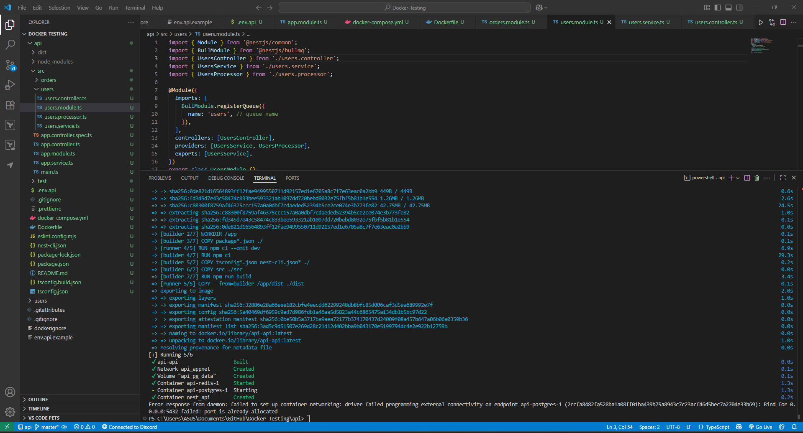

# Background Jobs with BullMQ & Redis in NestJS

Setup the BullMQ in the files code and run Docker

Run the program to check any errors

Testing the outputs

## Reflection

1. Why is BullMQ employed rather than processing tasks inline in API requests?

It is inefficient and dangerous to execute long-running or resource-intensive work inline with the request/response pipeline of contemporary apps. When an API endpoint sends emails, resizes images, or performs heavy computation synchronously, the client will wait, timeouts will result, and server throughput is impacted.

BullMQ has a clean mechanism of dumping expensive work off to background jobs. This design makes API responses remain fast and predictable, with background workers dealing with jobs asynchronously. It also makes it possible to scale the system horizontally because workers may be distributed across multiple servers without loading up the top-level API layer.

---

1. How does Redis assist in dealing with job queues in BullMQ?

Redis is utilized as a foundation for job queuing by BullMQ. It holds several lists and sets for every queue:

- Waiting, active, completed, and failed jobs are stored in separate Redis data structures.
- Atomic operations of Redis securely move jobs among states even if there are numerous workers.
- Delayed jobs and scheduling are intrinsically developed in Redis sorted sets, which have accurate execution times.
- Event streams (through Redis streams) allow BullMQ to publish events such as "completed" or "failed," which can be consumed for analytics and monitoring.

Through the use of Redis, BullMQ provides durability, fault tolerance, and support for very high throughput with low overhead.

---

1. What if a job fails? How to retry failed jobs?

When an employee tosses an error in the processing of a job, BullMQ transitions the job to the failed state. The reason for failure (message, stack trace) is saved into Redis to examine.

BullMQ has out-of-the-box retry strategies:

- The developers can have developers configure the number of attempts to retry per job.
- Between retries, backoff strategies (exponential delay, fixed delay) can be used.
- The jobs can be set to either remain in the failed set (debugging) or automatically be discarded after a number of attempts.

This makes the system immune to temporary problems like network connectivity flaws, third-party API timeouts, or database locks but will still expose issues that are ongoing and need the attention of developers.

---

1. How does BullMQ fit into Focus Bear for background jobs?

Focus Bear, a habit and task-tracking app, uses BullMQ in its NestJS server to execute background workflows that should not bring user interaction to a halt. A few examples are:

- Data synchronization: syncing user progress and analytics into cloud storage without making the app sluggish.
- Notifications and reminders: firing push or email notifications at some time, executed through queues.
- Third-party integrations: processing outbound calls to third-party services such as task management or calendars asynchronously with retries if the third-party service is down.
- Heavy calculations: processing report generation and habit analysis in background tasks instead of part of the API response cycle.

With pushing to BullMQ, Focus Bear keeps its backend responsive but still performing those nasty, stateful background jobs efficiently.