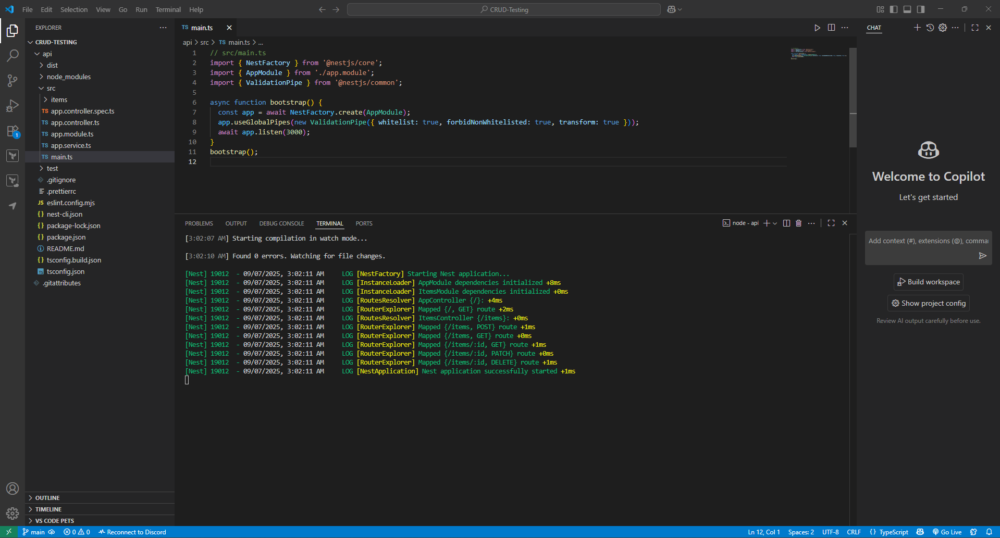

# Creating REST APIs with NestJS

## Setup the repository for the JSON files

## Upload the JSON files to POSTMAN

## Example of create item using raw JSON file in POSTMAN

## Reflection

### 1. Function of a Controller in NestJS

- A controller in NestJS is the point of entry to handle HTTP requests and return the response to the client.
- Controllers specify the routes of the application and bind them to certain methods using decorators like `@Get()`, `@Post()`, `@Put()`, and `@Delete()`.
- Controllers should only be responsible for transport-level issues such as routing, request parameter handling, and returning the appropriate response.

---

### 2. Separation of Business Logic from Controllers

- Controllers cannot be business logic written in.
- Rather, it is separated out into services or some other providers.
- Controllers pass input data to these services and return the result from the service.
- This makes controllers slim and just concerned with request and response handling while services implement the underlying logic of the application.

---

### 3. Importance of Utilizing Services Instead of Controllers

Using services has some advantages:

- **Single Responsibility**: Controllers handle routing; services handle logic.
- **Reusability**: Services can be reused by several controllers or even other providers.
- **Testability**: Services are unit-testable separately without HTTP issues.
- **Maintainability**: Prevents "fat controllers" and promotes cleaner project layout.
- **Scalability**: Services can be extended with things like caching, database queries, and remote integrations without touching controller code.

---

### 4. Automatic Mapping of HTTP Methods to Handlers

- NestJS, by default, maps HTTP methods to controller handlers via decorators:
    - `@Controller('items')` → sets the base route to `/items`.
    - `@Get()` → handles GET requests to `/items`.
    - `@Get(':id')` → handles GET requests to `/items/:id`.
    - `@Post()` → handles POST requests to `/items`.
    - `@Put(':id')` → handles PUT requests to `/items/:id`.
    - `@Delete(':id')` → handles DELETE requests to `/items/:id`.
- NestJS executes these decorators during runtime to create an internal routing table such that requests received are routed automatically to the respective controller methods.