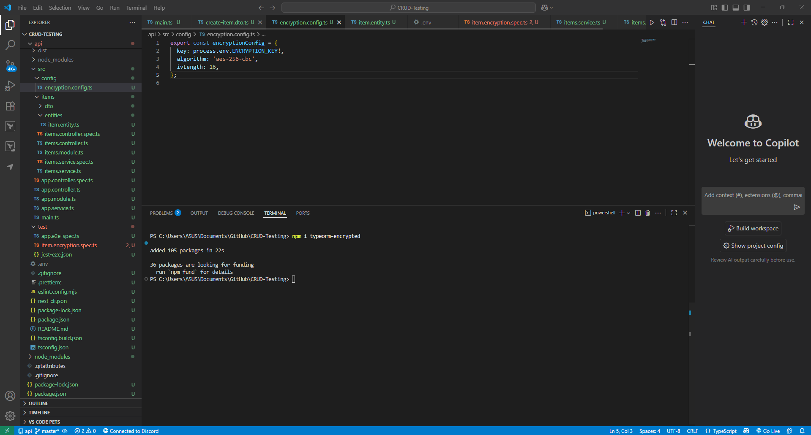

# Using typeorm-encrypted for Data Encryption

## **Implement `typeorm-encrypted` in a NestJS entity**

## Create encrypted file and items and testing

## Encryption Key Management in NestJS with typeorm-encrypted

### Introduction

Encryption is an important security step when protecting sensitive information in applications. The efficiency of encryption, though, is not simply an issue of algorithms but of encryption key generation, upkeep, and handling across the lifecycle of the system. This document is about how to implement typeorm-encrypted within a NestJS application and how keys need to be processed in a way that confidentiality and strength are maintained.

### Key Generation

In development, an AES-256 encryption key was needed for the typeorm-encrypted transformer. The key has to be precisely 32 bytes (64 hex characters) long. Rather than doing this by hand, it is created using a cryptographically secure pseudo-random number generator (such as Node's crypto.randomBytes(32)). This lowers predictability and is consistent with best cryptography practice.

### Key Storage

Development practice pressed toward isolating encryption keys from application logic. For local development, the secret was stored in a .env file within the root of the project and was injected with @nestjs/config. Environment files, though, are not secure enough in production. Keys must be stored within a separate secret management service like AWS Secrets Manager, Google Cloud Secret Manager, or Azure Key Vault. This isolation keeps accidental exposure out of version control and minimizes the risk of compromise in case a server is ever breached.

### Key Rotation

Rotation is an important consideration with encryption keys. Keys should not remain the same throughout the system's lifetime. Rotation methods range from keeping dual keys (old for decrypting, new for encrypting) to building shadow columns where data will be re-encrypted using the new key prior to retiring the old one. In our test setup, one static key was enough, but production environments need to use rotation in order to satisfy compliance and long-term security needs.

### Access Control

Encryption key access must be tightly regulated. The key should only be obtained and used by the application service layer; it should not directly be accessed by administrators, developers, or even the database engine. Role-based access controls and auditing logs should be implemented at the level of the secret manager in order to monitor and limit usage of keys. This way, even when database data is lost, it cannot be decrypted without the secure key.

### Testing

In the test suite, a deterministic test key was created at the beginning of the spec file. This ensured predictable encryption and decryption outcomes without accessing external services. The tests verified that although decrypted value was exposed at the repository level, the corresponding database column held nothing but ciphertext, demonstrating data at rest protection. This approach does not compromise test reproducibility for secure practices in production.

### Pitfalls Identified

The process also showcased common errors to be avoided:

- Hardcoding encryption keys within code or checking them into Git repositories.
- Keeping keys in the same database as encrypted data.
- Not rotating keys, with vulnerability for the long term if they become compromised.
- Trying to query encrypted columns natively; these queries take hashed secondary fields to lookup

## **Test encrypting and decrypting a database field**

The encryption test had also ensured the secretNote field of Item was encrypted at rest and implicitly decrypted upon reading. Creating a record with the value "Sensitive Data" and then reading it back via the repository, the test had demonstrated that the application is able to read back the plaintext that was initially stored, which demonstrates decryption works. Concurrently, a raw SQL query to the underlying database table guaranteed stored value was not in plaintext form but ciphertext form, which provides proof that data is safely encrypted before it gets stored. Cumulatively, these findings guarantee the database field is highly guarded by the typeorm-encrypted transformer.

## Reflection

# Report: Application and Database Encryption Practices in Security

## Introduction

Protection of confidential data is done by defense-in-depth measures that target storage as well as application-level threats. Although native encryption is supported by current databases, most applications, including Focus Bear, apply additional measures of security in the guise of encrypting application-level data even before it gets to the database. In this report, it describes double encryption usage, how typeorm-encrypted is integrated with TypeORM entities, encryption key management best practices, and the database-level vs. app-level encryption trade-offs.

## Double Encryption in Focus Bear

Double encryption is implemented in Focus Bear—encrypting data at the application level before they are saved in an already encrypted database. This design allows even when the database server or encryption module is breached, sensitive information is still safe as the attacker would still require the encryption key of the application to be able to decrypt it. Database encryption is typically only effective against disk theft or low-level storage compromise but not against privileged users having direct database access observe plaintext values. Application-level encryption hence adds an additional layer that reduces exposure in the event of a breach, insider attack, or misconfiguration.

## Typeorm-encrypted integration with TypeORM Entities

The typeorm-encrypted library can be easily integrated with TypeORM entities using value transformers. A transformer is used directly on an entity column definition so that the values are silently encrypted when stored in the database and silently decrypted upon read. For a quick example, an entity field like secretNote can be tagged with a transformer supporting AES-256-CBC encryption. When a developer saves an entity using a repository, the field gets silently encrypted; when the entity gets loaded, it gets silently decrypted. This solution makes it easier to implement because no extra logic is required in the service or controller layers, and it ensures sensitive fields are never stored in plaintext.

## Best Practice: Securing Encryption Keys

Encryption strength relies heavily upon the secure handling of encryption keys. Keys must be created using cryptographically secure pseudo-random number generators and must not be hardcoded into source code or version controlled. Environment variables can be used at development time for key injection, but at production time, they have to be used in specialized secret management services like AWS Secrets Manager, Azure Key Vault, or Google Cloud Secret Manager. Rotation policies on keys have to be enforced, using dual-write/read or shadow column facilities to re-encrypt data securely. Key access must be strictly controlled, accessible only by the application runtime, and audit logging must be enabled to trigger alerts on unauthorized access. Fixed keys can be used within test environments for reproducibility, but production environments must utilize secure lifecycle management practices.

## Trade-offs: Database-Level vs. Application-Level Encryption

Database-level encryption (for example, Transparent Data Encryption or column-level encryption) offers very good security in case of physical theft of disks, backup, or snapshot images. It is easy to implement and mostly transparent to the application. But it does little in the way of security against insiders or compromised database accounts because the database system will need to have access to the decryption keys.

Application-level encryption, on the other hand, keeps sensitive values encrypted even before they are sent to the database. This disallows even database administrators from viewing plaintext data, so the risk of disclosure is lowered significantly. The trade-off is lower queryability as encrypted columns will not be available in filters, sorts, and joins without extra hashed index columns. Application-level encryption also adds more key management and rotation complexities.

In practice, the most secure approach uses both methods together: database-level encryption for security of all data stored overall, and application-level encryption for sensitive fields that require maximum secrecy.