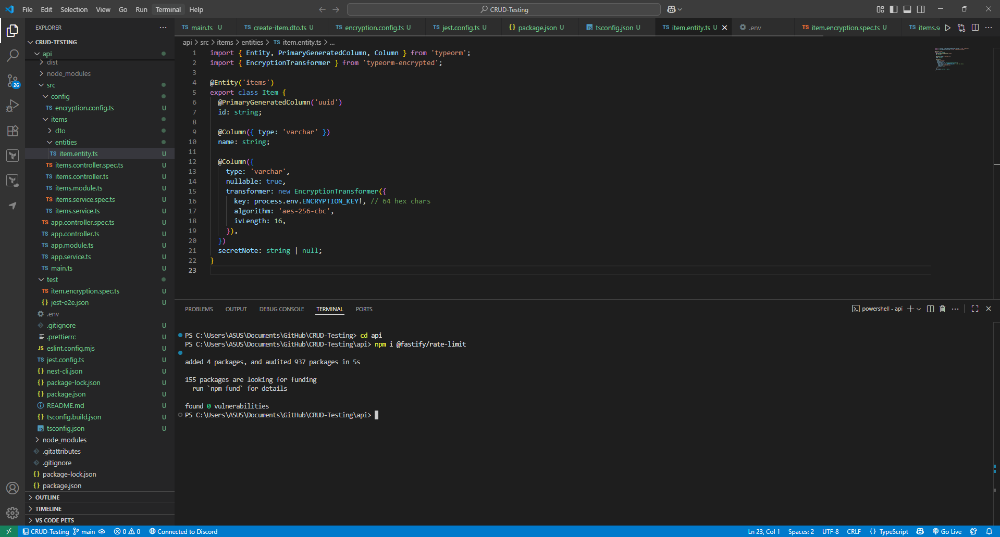

# Security Best Practices in NestJS

## **Implement request rate limiting using `@fastify/rate-limit`**



## Testing the implementaion of RateLimit


# Security Vulnerabilities and Countermeasures in NestJS Applications

## 1. General Security Vulnerabilities in NestJS

NestJS applications, like any typical web framework, are prone to a number of general security vulnerabilities.

### Injection Attacks

Applications are susceptible to SQL or NoSQL injection when raw user input is appended directly into queries. To counter this, developers should use parameterized queries from Object-Relational Mapping (ORM) libraries such as TypeORM or Prisma. Additionally, inputs should be validated and sanitized at the application boundary. In NestJS, this is achieved by activating global validation pipes using options such as `whitelist`, `forbidNonWhitelisted`, and `transform`.

### CORS Misconfigurations

Cross-Origin Resource Sharing (CORS) misconfigurations can enable unauthorized access to APIs. A common example is using `origin: '*'` together with `credentials: true`, which can expose critical vulnerabilities. To avoid this, CORS must be explicitly configured for trusted origins, methods, and headers.

### Weak or Missing Security Headers

HTTP headers are a vital aspect of safeguarding clients against malicious content and enforcing strict policies. Without secure headers, applications are exposed to risks such as clickjacking and MIME sniffing. NestJS applications should therefore integrate middleware such as Helmet to automatically add secure headers.

### Brute Force and Scraping

APIs that do not implement request rate limiting are susceptible to brute-force attacks on authentication endpoints and automated scraping. Adding rate limiting ensures that clients cannot overwhelm the server with excessive requests, thus protecting server availability and performance.

### Secret Leakage

Inadequate handling of sensitive information, such as database credentials and API keys, can make applications vulnerable to compromise. Secrets should never be hardcoded or logged. Instead, they must be securely stored in environment variables or secret managers with strict access controls and regular rotation policies.

---

## 2. Hardening HTTP Headers with Helmet

Helmet is a widely used middleware that simplifies the process of securing HTTP headers by offering sensible defaults.

In **Fastify-based NestJS projects**, Helmet can be installed as a plugin (`@fastify/helmet`). It enforces the following protections:

- **X-Content-Type-Options**: Prevents MIME type sniffing.
- **Cross-Origin-Resource-Policy** and **Cross-Origin-Opener-Policy**: Prevent data leakage across different origins.
- **Content-Security-Policy (CSP)**: Restricts the origins from which scripts, styles, and images can be loaded.
- **Strict-Transport-Security (HSTS)**: Enforces HTTPS communication.
- **Removal of the X-Powered-By header**: Prevents disclosing the underlying framework.

For **Express-based NestJS applications**, the `helmet` package offers the same protections when included as middleware. By enforcing these headers, developers can significantly reduce the attack surface of web applications by enabling robust browser-level security controls.

---

## 3. Secure Storage of API Keys and Environment Variables

Sensitive information such as API keys, database connection URLs, and third-party service credentials must be stored securely.

### Configuration Management

NestJS provides the `@nestjs/config` module to facilitate centralized configuration management and to load environment variables from `.env` files. Validation libraries such as Joi can be used to ensure that required keys exist and satisfy defined constraints (e.g., minimum length, valid format).

### Secure Practices

- Environment variables should never be committed to source control.
- In production, secrets should be managed by dedicated secret management platforms such as **AWS Secrets Manager**, **Google Secret Manager**, or **HashiCorp Vault**.
- Applications should log errors without exposing secret values.
- Secrets should be scoped to the minimum privileges required and rotated frequently to minimize damage if compromised.
- Secrets should be injected at runtime by containers or orchestrators (e.g., Docker, Kubernetes) rather than baked into application images.

### Implementation Example

```tsx
@Module({
  imports: [
    ConfigModule.forRoot({
      isGlobal: true,
      validationSchema: Joi.object({
        DATABASE_URL: Joi.string().uri().required(),
        STRIPE_SECRET: Joi.string().min(10).required(),
      }),
    }),
  ],
})
export class AppModule {}

```

This configuration ensures that the application will not boot if required environment variables are absent or incorrectly formatted, thereby reducing the risk of insecure deployments.

## Reflection

## 1. NestJS Common Security Vulnerabilities

NestJS applications, similar to all web frameworks, are vulnerable to a variety of common security vulnerabilities that can undermine system integrity and confidentiality unless they are addressed.

### Injection Attacks

Applications are vulnerable to SQL and NoSQL injection most frequently when user input is string concatenated in database queries. This vulnerability can enable attackers to exfiltrate or manipulate sensitive data. Parameterized queries with ORMs like TypeORM or Prisma and robust input validation and sanitization offer effective protection.

### CORS Misconfigurations

Poorly configured Cross-Origin Resource Sharing (CORS) policies represent another important security vulnerability. Perhaps the most prevalent misconfiguration is initializing `origin: '*'` along with `credentials: true`, which allows cross-domain access by the application without authorization. Limiting origins, headers, and methods to clearly trusted values prevents this attack.

### Weak or Missing Security Headers

HTTP response headers play an important role in enforcing security on the browser side. Without them, applications would be vulnerable to clickjacking, MIME sniffing, and cross-site scripting attacks. Middleware like Helmet ensures that the correct security headers are sent automatically.

### Brute Force and Automated Abuse

Authentication APIs and public APIs are susceptible to brute-force attacks as well as automated scraping without sufficient defense. These attacks can negatively affect performance and compromise user accounts. Request rate limiting helps prevent clients from overwhelming the system with too many requests.

### Secret Leakage

Insecure storage of sensitive information like database passwords and API keys poses a significant security risk. Storing secrets in code or logs exposes them if source control is compromised. Secure storage through the use of environment variables or secret managers counteracts leakage.

---

## 2. Securing with @fastify/helmet

The `@fastify/helmet` package secures NestJS applications by applying a subset of security-related HTTP headers. These headers prevent typical browser-based attacks and provide defense-in-depth at the transport layer. Key protections include:

- **X-Content-Type-Options:** Stops MIME type sniffing in responses by browsers.
- **Cross-Origin-Resource-Policy and Cross-Origin-Opener-Policy:** Minimizes data leaks across origins.
- **Content-Security-Policy (CSP):** Limits allowed sources for scripts, images, and styles, reducing the risk of cross-site scripting (XSS) attacks.
- **Strict-Transport-Security (HSTS):** Enforces strict HTTPS use, rejecting protocol downgrade attacks.
- **X-Powered-By Header Removal:** Prevents publishing the framework running the application, making it harder to fingerprint.

By activating these protections, Helmet greatly reduces the attack surface of NestJS applications and aligns them with web application security best practices.

---

## 3. Role of Rate Limiting

Rate limiting is a significant defense for protecting APIs from malicious or improper usage.

- **Brute Force Mitigation:** Restricts repeated authentication requests, preventing credential-stuffing attacks.
- **Denial-of-Service Prevention:** Discourages requests from coming too frequently, maintaining availability during attempted overloads.
- **Fair Usage Enforcement:** Ensures equitable usage of resources and prevents a single client from monopolizing bandwidth.
- **Bot and Scraper Control:** Discourages automated scraping attempts or spam targeting the application.

In NestJS, rate limiting can be enabled globally or on specific routes, balancing usability and security.

---

## 4. Safeguarding Sensitive Configuration in Production

Sensitive configuration values like API keys and database URIs must be kept secure when deployed in production.

### Environment Variables and Config Management

Sensitive values must never be hardcoded within source code. Instead, they need to be stored in environment variables, with the `@nestjs/config` module providing centralized management. Libraries such as Joi can validate the presence and correctness of required keys.

### Secret Management Systems

For commercial use, secret management solutions like **AWS Secrets Manager**, **Google Secret Manager**, or **HashiCorp Vault** securely store secrets, provide automated rotation, and enforce access controls.

### Secure Practices

- Do not store secrets in source control.
- Rotate keys regularly to minimize exposure.
- Scope secrets according to the principle of least privilege.
- Inject secrets at runtime with container orchestrators such as Docker or Kubernetes rather than baking them into images.
- Ensure application logs never leak sensitive values.

By following these practices, organizations can minimize the risk of secret exposure while achieving compliance with industry security best practices.