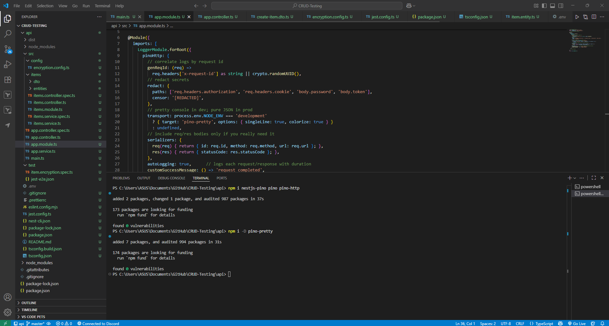

# Logging & Error Handling in NestJS

## Install nestjs-pino



## **Set up structured logging using `nestjs-pino` and Implement a custom exception filter to format API error responses**


## Reflection

# Logging and Exception Handling in NestJS Applications

## 1. Advantages of Using nestjs-pino for Logging

The `nestjs-pino` module offers a structured and high-performance logging system for NestJS applications. NestJS logger, the default logger, produces human-readable logs, whereas `nestjs-pino` makes use of the Pino logging library to produce lightweight, structured JSON logs.

The main advantages are:

- **Performance:** Pino is one of the fastest Node.js logging libraries with negligible application overhead even at high traffic.
- **Structured Output:** Machine-readable JSON-format logs are simple to parse by log aggregation systems like ELK (Elasticsearch, Logstash, Kibana) or Grafana Loki.
- **Request Context Correlation:** Built-in request ID support enables correlation of logs throughout the life cycle of a request, making debugging and tracing distributed systems easy.
- **Redaction Support:** Sensitive information, like authentication headers or tokens, are automatically redacted to meet security policies.
- **Flexible Transports:** Pretty-print for local development and ship raw JSON logs to monitor systems at production.

In general, `nestjs-pino` closes the gap between application developers and systems for observability so that logs become developer-friendly and production-ready.

---

## 2. Role of Global Exception Handling in API Consistency

Global exception handling in NestJS guarantees that every exception is caught and converted to a consistent response format. Without global exception filtering, each module or service could throw exceptions of different formats, leaving API consumers in the dark and making client-side exception handling more difficult.

The advantages of global exception handling are:

- **Uniform Error Responses:** The client always receives a structured payload (e.g., `{ statusCode, error, message, path, timestamp }`) irrespective of the exception type.
- **Enhanced Client Experience:** External or frontend services can securely parse errors and return proper messages.
- **Unified Logging:** Exceptions are piped through a solitary filter, allowing for unified logging with contextual information like request ID, URL, and HTTP method.
- **Security:** Sensitive nature error details (e.g., stack traces) can be masked, but client-friendly messages are returned to the client.

In brief, world-wide exception handling puts a common contract on error communication and enhances API strength and usability.

---

## 3. Logging Interceptor vs. Exception Filter

Filters and interceptors both help with observability and error handling but serve different functions in the NestJS request life cycle.

### Logging Interceptor

- Executes before and after processing a request.
- Logs data like method, URL, execution time, and response status.
- Good for logging performance metrics and request/response latency.
- **Example:** logging all request latencies (`GET /items → 120ms`).

### Exception Filter

- Executes only on exception throw.
- Maps the exception to a standard HTTP response.
- Logs errors with context information (e.g., request ID, stack trace).
- **Example:** converting a `NotFoundException` into `{ "statusCode":404, "error":"Not Found", "message":"Item not found" }`.

**Key difference:**

- **Interceptors** → log all requests (success or failure).
- **Filters** → log and handle exceptions only.

---

## 4. Structuring Logs for Effectiveness in Debugging

Logs need to be truly effective in a balance of clarity, context, and security. Structured JSON logs are especially strong since they can be effectively indexed and queried in observability systems. Effective structuring of logs in NestJS is as follows:

- **Include Core Fields:** Record the timestamp, level, message, context (like service name), and requestId for correlation at all times.
- **Request Metadata:** Log method, url, statusCode, responseTime, and, where applicable, user identifiers.
- **Error Details:** Log the error name, stack trace (for internal logs), and sanitized message on exceptions.
- **Custom Fields:** Include operation-specific metadata, i.e., `{ op: 'createItem', itemId: 42 }` to identify which operation led to the log.
- **Redaction:** Make sure to redact or mask sensitive information like tokens, passwords, or personal identifiers.
- **Consistency:** Employ a uniform schema across services so that logs can be easily aggregated and analyzed uniformly.

### Example of a well-formatted log entry

```json
{
  "level": "error",
  "timestamp": "2025-09-10T14:10:00.123Z",
  "context": "ItemsService",
  "requestId": "abc123",
  "method": "GET",
  "url": "/items/999",
  "statusCode": 404,
  "message": "Item not found",
  "stack": "NotFoundException: Item 999 not found."
}

```

This level of organization makes logs human-readable to developers and machine-parseable to log aggregation tools.