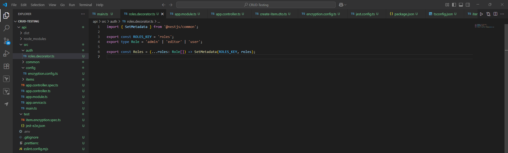

# Role-Based Authorization (RBAC) in NestJS

## **Implement a NestJS guard to enforce role-based authorization**

### Add a `@Roles()` decorator



### Create a `RolesGuard`


### Testing access token


### Protecting admin access


## Reflection

## 1. Auth0 Storage and User Role Management

Auth0 provides a native Role-Based Access Control (RBAC) mechanism that enables administrators to define roles (e.g., *admin*, *editor*, *viewer*) and map them to specific permissions. These roles are then assigned to users through the Auth0 Dashboard or Management API. Once roles are associated with a user, Auth0 can embed them in the user’s JWT access tokens. In practice, this is achieved either through the `permissions` claim or by using a custom namespaced claim such as `https://your-domain/roles`. This centralized architecture consolidates both identity and authorization logic, thereby simplifying the management of consistent access policies across multiple applications and APIs.

## 2. Role of a Guard in NestJS

A guard in NestJS functions like middleware that determines whether a request may proceed to the route handler. Guards are executed after authentication but before the controller method is called, making them ideal for handling **authorization logic**. For example, a `JwtAuthGuard` ensures that the incoming request includes a valid token, while a `RolesGuard` checks whether the authenticated user has the appropriate roles required to access a given resource. Guards therefore allow developers to implement reusable, declarative security rules that can be applied at the route, controller, or even the global application level.

## 3. Denying Access to an API Endpoint Based on User Role

Restricting access based on user role generally requires a combination of authentication and authorization:

- **Authentication**: A `JwtAuthGuard` verifies the JWT token and assigns the decoded payload to `request.user`.
- **Authorization**: A `RolesGuard` checks the roles within `request.user` against the roles expected by the endpoint.
- **Decorator Usage**: A `@Roles('admin')` decorator specifies that only users with the *admin* role can access the method.

**Example:**

```tsx
@Get('admin')
@Roles('admin')
@UseGuards(JwtAuthGuard, RolesGuard)
getAdminData() {
  return { secret: 'Admins only 🚀' };
}

```

This configuration prevents even authenticated users from accessing the endpoint unless their token explicitly includes the required role.

## 4. Security Impacts of Inappropriate Authorization and Mitigation

Improper authorization is one of the most significant security threats in web applications. Its potential impacts include:

- **Privilege Escalation**: A normal user may gain unauthorized access to administrative endpoints if role checks are missing or misconfigured.
- **Data Leakage**: Confidential information could be exposed to unauthorized users, compromising confidentiality.
- **Unauthorized Activities**: Malicious users could perform destructive actions such as deleting records or altering configurations.

### Mitigation Techniques

- **Defense-in-Depth**: Combine multiple layers of authentication and role-based authorization rather than relying on a single mechanism.
- **Principle of Least Privilege**: Assign users only the minimal roles and permissions necessary to perform their tasks.
- **Token Integrity**: Ensure all tokens are securely signed and validated on every request; never trust role claims provided directly by the client.
- **Auditing and Monitoring**: Maintain detailed logs of access attempts and set alerts for suspicious activity.
- **Regular Policy Review**: Periodically review and update roles and permissions in Auth0 to minimize the risk of over-privileged accounts.