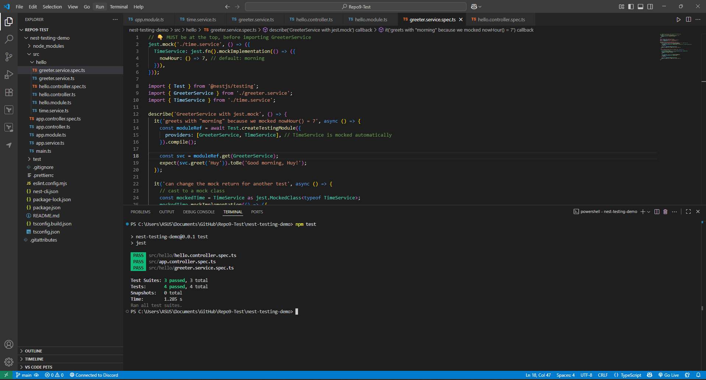

# Writing Unit Tests for Services & Controllers in NestJS

## **Write a unit test for a simple NestJS service**

```tsx
import { Test } from '@nestjs/testing';
import { HelloController } from './hello.controller';
import { GreeterService } from './greeter.service';

describe('HelloController', () => {
  it('returns message from GreeterService', async () => {
    const greeterMock = { greet: jest.fn().mockReturnValue('Good afternoon, Huy!') };

    const moduleRef = await Test.createTestingModule({
      controllers: [HelloController],
      providers: [{ provide: GreeterService, useValue: greeterMock }],
    }).compile();

    const ctrl = moduleRef.get(HelloController);

    const res = ctrl.sayHello('Huy');
    expect(res).toEqual({ message: 'Good afternoon, Huy!' });
    expect(greeterMock.greet).toHaveBeenCalledWith('Huy');
  });
});

```

## **Mock dependencies using `jest.mock()` or NestJS’s testing utilities**

```tsx
// MUST be at the top, before importing GreeterService
jest.mock('./time.service', () => ({
  TimeService: jest.fn().mockImplementation(() => ({
    nowHour: () => 7, // default: morning
  })),
}));

import { Test } from '@nestjs/testing';
import { GreeterService } from './greeter.service';
import { TimeService } from './time.service';

describe('GreeterService with jest.mock', () => {
  it('greets with "morning" because we mocked nowHour() = 7', async () => {
    const moduleRef = await Test.createTestingModule({
      providers: [GreeterService, TimeService], // TimeService is mocked automatically
    }).compile();

    const svc = moduleRef.get(GreeterService);
    expect(svc.greet('Huy')).toBe('Good morning, Huy!');
  });

  it('can change the mock return for another test', async () => {
    // cast to a mock class
    const mockedTime = TimeService as jest.MockedClass<typeof TimeService>;
    mockedTime.mockImplementation(() => ({
      nowHour: () => 20, // evening
    }));

    const moduleRef = await Test.createTestingModule({
      providers: [GreeterService, TimeService],
    }).compile();

    const svc = moduleRef.get(GreeterService);
    expect(svc.greet('Huy')).toBe('Good evening, Huy!');
  });
});
// 👇 MUST be at the top, before importing GreeterService
jest.mock('./time.service', () => ({
  TimeService: jest.fn().mockImplementation(() => ({
    nowHour: () => 7, // default: morning
  })),
}));

import { Test } from '@nestjs/testing';
import { GreeterService } from './greeter.service';
import { TimeService } from './time.service';

describe('GreeterService with jest.mock', () => {
  it('greets with "morning" because we mocked nowHour() = 7', async () => {
    const moduleRef = await Test.createTestingModule({
      providers: [GreeterService, TimeService], // TimeService is mocked automatically
    }).compile();

    const svc = moduleRef.get(GreeterService);
    expect(svc.greet('Huy')).toBe('Good morning, Huy!');
  });

  it('can change the mock return for another test', async () => {
    // cast to a mock class
    const mockedTime = TimeService as jest.MockedClass<typeof TimeService>;
    mockedTime.mockImplementation(() => ({
      nowHour: () => 20, // evening
    }));

    const moduleRef = await Test.createTestingModule({
      providers: [GreeterService, TimeService],
    }).compile();

    const svc = moduleRef.get(GreeterService);
    expect(svc.greet('Huy')).toBe('Good evening, Huy!');
  });
});
// 👇 MUST be at the top, before importing GreeterService
jest.mock('./time.service', () => ({
  TimeService: jest.fn().mockImplementation(() => ({
    nowHour: () => 7, // default: morning
  })),
}));

import { Test } from '@nestjs/testing';
import { GreeterService } from './greeter.service';
import { TimeService } from './time.service';

describe('GreeterService with jest.mock', () => {
  it('greets with "morning" because we mocked nowHour() = 7', async () => {
    const moduleRef = await Test.createTestingModule({
      providers: [GreeterService, TimeService], // TimeService is mocked automatically
    }).compile();

    const svc = moduleRef.get(GreeterService);
    expect(svc.greet('Huy')).toBe('Good morning, Huy!');
  });

  it('can change the mock return for another test', async () => {
    // cast to a mock class
    const mockedTime = TimeService as jest.MockedClass<typeof TimeService>;
    mockedTime.mockImplementation(() => ({
      nowHour: () => 20, // evening
    }));

    const moduleRef = await Test.createTestingModule({
      providers: [GreeterService, TimeService],
    }).compile();

    const svc = moduleRef.get(GreeterService);
    expect(svc.greet('Huy')).toBe('Good evening, Huy!');
  });
});

```

## Testing output



## Reflection

## 1. Significance of Testing Services Separately from Controllers

Services hold the business logic within a NestJS application, whereas controllers are interfaces to send and receive HTTP requests and responses. It is significant to test services separately from controllers so that the business logic is in its suitable form and reliable without getting overwhelmed by request/response handling. This isolation of concerns speeds up tests, makes them more isolatable, and less prone to breaking due to API routing changes. Provided that services are thoroughly tested, then controllers can be tested with confidence that the internal mechanics already function as they should, avoiding redundancy and keeping controller tests focused on input validation and response formatting.

---

## 2. Role of Mocking Dependencies in Unit Testing

Mocking enables developers to substitute actual dependencies (e.g., database access, external APIs, or other services) with light-weight mocks. Mocks in NestJS are done using `jest.fn()`, `useValue`, or `jest.mock()`. This enhances unit testing through:

- **Isolation**: Prevents the unit being tested from being influenced by foreign state or network calls.
- **Determinism**: Offers repeatable and predictable results and avoids flaky tests due to real data or network latency.
- **Speed**: Tests execute much quicker because they avoid slow operations such as database queries or HTTP requests.
- **Focus**: There is an obvious potential for testing the logic of a class in isolation from the behavior of its dependencies.

---

## 3. Common Pitfalls When Writing Unit Tests in NestJS

Even with its well-organized testing tools, developers face challenges when writing tests for NestJS:

- **Over-reliance on integration tests**: Integration of controller, service, and module problems might mask the target unit test, hence test suites become brittle and slow.
- **Misuse of mocking**: Neglecting that dependencies have to be mocked or doing it improperly can lead to flaky tests or passing tests which don't actually test logic.
- **Testing implementation details**: Too tightly coupled tests composed to internal code structure instead of behavior can make refactoring more difficult.
- **Failing to handle edge cases**: Picking only "happy paths" (i.e., good inputs) and not executing failure cases (i.e., bad data, exceptions) leaves room for gaps in testing.
- **Global test setup mistakes**: Abusing `beforeAll` and `afterAll` hooks or causing module states to leak between tests can produce side effects that pollute results.

---

## 4. Getting Unit Tests to Cover All Edge Cases

In order to cover all, the following techniques must be used:

- **Equivalence partitioning**: Test typical inputs of valid and invalid partitions to test robustness.
- **Boundary value analysis**: Test explicit boundaries (e.g., zero, negative numbers, max value, empty strings).
- **Error and exception handling**: Test thrown exceptions, rejected promises, or non-existent services to test proper error responses.
- **Mock behavior variations**: Set mocks to return different scenarios (success, failure, empty result) to test resilience of the unit.
- **Code coverage tools**: Utilize Jest's built-in coverage reports (`npm run test:cov`) to determine lines and functions that are not tested.
- **Peer review of test cases**: Request code reviews that not only check implementation but also test coverage.