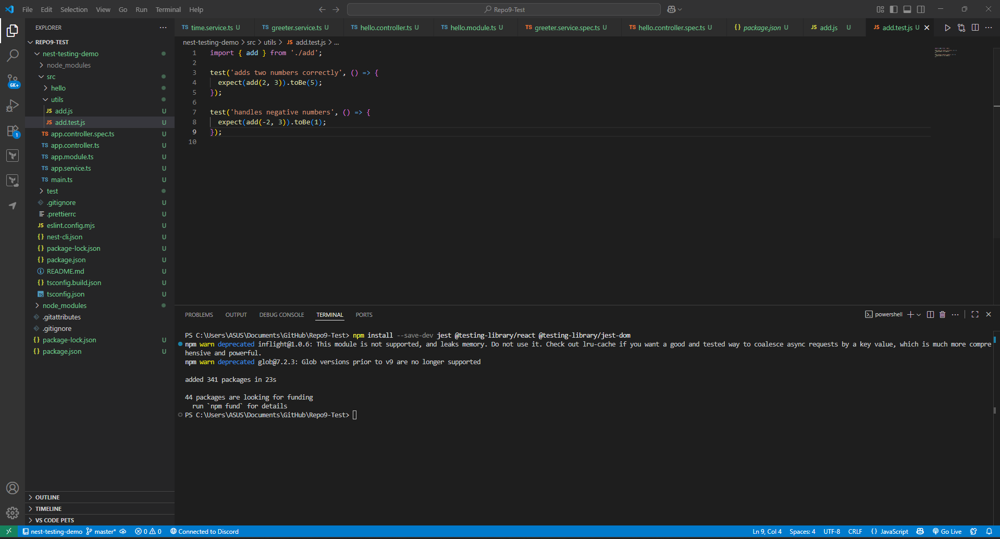

# Introduction to Unit Testing with Jest

## Setup Jest testing in the NestJS



## **Write a simple test for a utility function (e.g., a function that adds two numbers).**

```jsx
import { add } from './add';

test('adds two numbers correctly', () => {
  expect(add(2, 3)).toBe(5);
});

test('handles negative numbers', () => {
  expect(add(-2, 3)).toBe(1);
});

```

```jsx
export function add(a, b) {
  return a + b;
}
```

## Run the test


## Push the test to GitHub (confirmed it has been pushed)


## Reflection

## 1. Need for Automated Testing in Software Development

Automated testing is critical to the reliability, quality, and maintainability of contemporary software systems. Although manual testing is time-consuming and error-prone, automated testing enables developers to execute pre-defined test cases over and over and very swiftly on varied environments. The primary advantages are:

- **Consistency and Reliability**: Tests are executed the same way repeatedly, eliminating the ability for human error and ensuring regressions are captured as soon as they occur.
- **Fast Feedback Loop**: Tests can be integrated into continuous integration (CI) pipelines and can give developers immediate feedback when changes cause bugs.
- **Better Code Quality**: Through writing tests along with the code, developers are motivated towards creating modular testable units of code, resulting in better architecture and less technical debt.
- **Cost Savings**: While writing tests is some effort at first, automated tests save time and expense in the long term by minimizing extensive manual testing.
- **Confidence in Deployment**: Automated testing ensures new functionality and bug fixes do not break what is already working, enabling teams to deploy software releases with increased confidence and speed.

In short, automated testing is a critical practice for creating reliable applications, particularly as project complexity and team size grow.

---

## 2. Challenges Encountered When Writing the First Jest Test

Creating the very first Jest test is learning for the majority of developers, especially when they are testing library newcomers. The most significant challenges are usually:

- **Testing Concepts**: Beginners are sometimes confused by unit, integration, and end-to-end testing. It may initially be puzzling to determine what exactly must be tested at each level.
- **Setting Up the Environment**: Although setting up Jest in a project, particularly a project written in TypeScript or frameworks like React or NestJS, is generally straightforward, it might need some special configuration like installing test libraries, adding a test script, or resolving modules.
- **Mocking Dependencies**: For the initial test, new users might wonder how they should mock services, APIs, or utility functions. There are several ways Jest offers (`jest.fn()`, `jest.spyOn()`, or custom mocks), which may overwhelm new users.
- **Reading Test Failures**: Error messages of failed tests may appear daunting initially. It takes practice to be able to comprehend why a test has failed because of invalid expectations, logic bug in code, or incorrectly configured mock.
- **Assertion Writing**: Becoming proficient at writing Jest's assertion methods (e.g., `toBe`, `toEqual`, `toHaveBeenCalledWith`) correctly takes practice and initially might feel awkward but in due course, becomes second nature.

In spite of all of this, the initial Jest test is an educational exercise. Overcoming the initial hurdle makes one more confident in testing and provides a foundation for developing more complete and sustainable test suites.