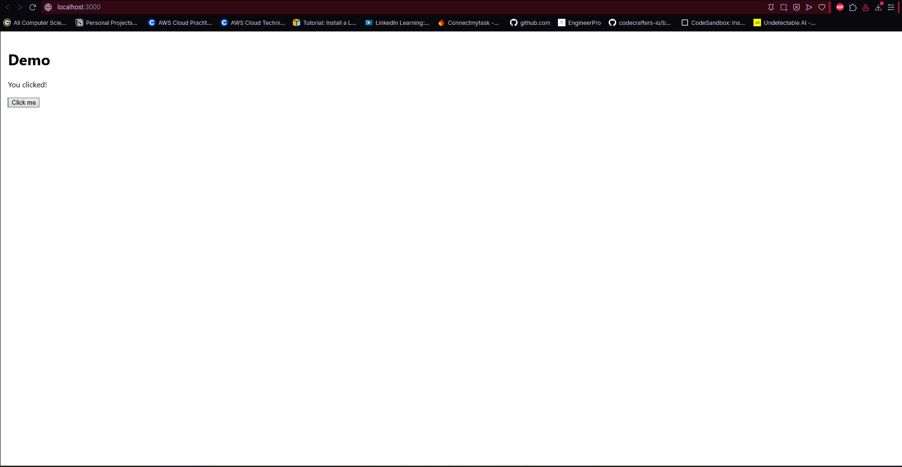

# Testing React Components with Jest & React Testing Library

## **Create a simple React component that displays a message.**

```tsx
import React from 'react';

type Props = { message?: string };

export default function SimpleMessage({ message = 'Hello, world!' }: Props) {
  const [clicked, setClicked] = React.useState(false);

  return (
    <div>
      <p aria-label="message">{clicked ? 'You clicked!' : message}</p>
      <button onClick={() => setClicked(true)}>Click me</button>
    </div>
  );
}

```



## **Write a test that checks if the component renders correctly  and a test that simulates user interaction (e.g., clicking a button).**

```tsx
import { render, screen } from '@testing-library/react';
import userEvent from '@testing-library/user-event';
import SimpleMessage from './SimpleMessage';

beforeEach(() => {
  jest.resetAllMocks();
});

test('renders default message', () => {
  render(<SimpleMessage />);
  expect(screen.getByLabelText('message')).toHaveTextContent(/hello, world!/i);
});

test('shows clicked state after button press', async () => {
  render(<SimpleMessage />);
  const user = userEvent.setup();
  await user.click(screen.getByRole('button', { name: /click me/i }));
  expect(screen.getByLabelText('message')).toHaveTextContent(/you clicked!/i);
});

```

## Run the test


## Push to GitHub


## Reflection

## 1) Advantages of React Testing Library (RTL) over Testing Implementation Details

**User-facing & accessible tests:** RTL prefers api calls such as getByRole, getByLabelText, and getByText, which are more similar to what an actual user would experience. This also exposes accessibility gaps earlier.

**Refactor resilience:** Behavior-based tests (visible text/roles) pass refactors to internals (state shape, hook usage, component boundary) if UX remains the same.

**Less coupling & more intent:** You test outputs (what's rendered, enabled, announced) instead of internals (instance methods, private state), less brittle whites-box tests.

**Closest-to-browser interactions:** With @testing-library/user-event, events are focus/blur, key combos, and default actions—closer to the browser than with fireEvent.

**Better async handling:** Built-ins like findBy* and waitFor simulate real render/update loops, fewer timing hacks.

**Maintainability & readability:** Tests are like usage examples; failure messages bound to roles/labels are quicker to respond to.

**Works beautifully with network mocking:** Paired with MSW or simple global.fetch mocks, tests remain speedy and deterministic without hitting actual APIs.

---

## 2) Problems Faced When Mocking User Interaction (and Workarounds)

**Forgetting to await interactions**

Problem: user.click/user.type are async; assertions are called too soon.

Solution: const user = userEvent.setup(); await user.click(btn); Use await everywhere.

**Racing async UI updates**

Issue: Asserting with getBy* before the DOM stabilizes (spinners, slow renders).

Resolution: Use await screen.findByText(.) or await waitFor(.); for spinners, await waitForElementToBeRemoved(.).

**Correctly mocking network requests**

Issue: Tests are hanging or failing due to real fetches or stale mocks.

Resolution: Stub global.fetch (or use MSW), validate request shape, and reset between tests (jest.resetAllMocks()).

**Timers/debounced handlers**

Issue: Handler with setTimeout/debounce never gets called.

Resolution: jest.useFakeTimers() and advance time (then jest.useRealTimers()), enclosing advances in act where necessary.

**Targeting the correct elements**

Issue: Can't select controls because they have no roles/labels.

Fix: Add semantic markup/labels (e.g., `<button>Save</button>`, aria-label, `<label htmlFor=…>`), then select by role/label.

**Portals/modals & focus management**

Issue: Elements appear outside the test container; focus assertions flaky.

Fix: Select document.body when necessary; assert using toHaveFocus() and role/label on the portal content.

**Controlled inputs**

Issue: fireEvent.change doesn't reflect real typing behavior.

Fix: Use await user.type(input, 'text') or await user.clear(input) to reflect real user flows.

**StrictMode double effects & state leakage**

Problem: Unwanted side effects in dev from other renders; residual mocks/timers ruin subsequent tests.

Solution: Design code idempotent effects; remove in afterEach and call jest.clearAllMocks()/resetAllMocks().

**Environment constraints (JSDOM)**

Problem: No CSS/layout, no unsupported APIs (e.g., IntersectionObserver).

Solution: Fake unsupported APIs; reschedule visual/layout tests to E2E/visual tests.