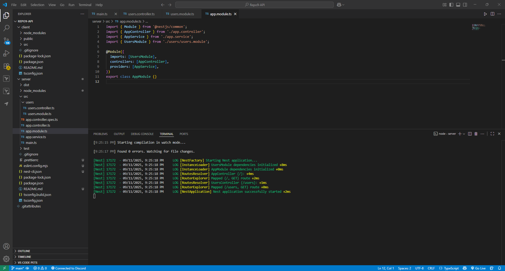

# Mocking API Calls in Jest

## Setup for server side



## Setup for client side


## Write a Jest test that **mocks** the API call

```
import React from 'react';
import { render, screen } from '@testing-library/react';
import Users from './Users';
import '@testing-library/jest-dom';

describe('Users component', () => {
  beforeEach(() => {
    jest.resetAllMocks();
  });

  test('renders list from API', async () => {
    // Arrange: mock the fetch() call
    global.fetch = jest.fn().mockResolvedValue({
      ok: true,
      json: async () => [
        { id: 1, name: 'Huy' },
        { id: 2, name: 'Alice' },
      ],
    } as any);

    render(<Users />);

    // Loading state visible first
    expect(screen.getByText(/Loading users/i)).toBeInTheDocument();

    // Then the users appear
    expect(await screen.findByText('Huy')).toBeInTheDocument();
    expect(screen.getByText('Alice')).toBeInTheDocument();

    // Verify the correct endpoint
    expect(global.fetch).toHaveBeenCalledWith('http://localhost:3000/users');
  });

  test('renders error when API fails', async () => {
    global.fetch = jest.fn().mockResolvedValue({
      ok: false,
      status: 500,
    } as any);

    render(<Users />);
    expect(await screen.findByRole('alert')).toHaveTextContent(/error/i);
  });
});

```

## Test Output


## Push to GitHub


## Reflection

1. Why Mocking API Calls Is Important In Tests

Determinism & Isolation

Mocking eliminates uncertainty from outside to the test (network speed, server uptime, data drift), and tests are deterministic and stable. It isolates the unit being tested (a React component or service, for example) from the backend.

Speed & Cost

Actual HTTP requests slow down the suite, add to CI time, and can incur API usage costs or be rate-limited. Mocks execute in milliseconds.

Reliability in CI/CD

CI environments give sparse egress or flaky networks. Mocking prevents pipeline failure because of infrastructure problems.

Coverage of Edge Cases

It is difficult to hit 500s, timeouts, corrupt payloads, or huge responses with a real server. Mocks allow you to test such routes end-to-end.

Security & Data Privacy

Tests should never hit prod or rely on secrets. Mocking prevents token exposure and hitting actual user data.

Clearer Failure Signals

When tests break with mocks, it's probably in application logic and not the network.

Practical note (React/Jest): mock `global.fetch`/Axios or use MSW (Mock Service Worker) for higher-level tests; restrict unit tests to small with `jest.fn()`/`jest.spyOn()` and component tests with `findBy*`/`waitFor`.

---

1. Common Mistakes When Testing Async Code (and How to Avoid Them)

Not Awaiting Async Work

Symptom: Tests pass or fail randomly; assertions execute before updates complete.

Use `async/await`, `await screen.findBy*`, or `await waitFor(.)`. Return/await promises instead of naked `setTimeout`.

Combining done Callbacks and Promises

Symptom: Flaky tests or false positives.

Fix: Try `async/await` first. Use `done` only for callback-style APIs; call it exactly once.

Ignoring Rejections / Unhandled Promises

Symptom: "UnhandledPromiseRejection" warnings; flaky results.

Fix: Assert rejections explicitly: `await expect(promise).rejects.toThrow()`. Use `expect.assertions(n)` when necessary.

Misuse of Fake Timers

Symptom: Timers never fire; components never update.

Fix: When using Jest fake timers, move forward in time: `jest.useFakeTimers(); await act(() => jest.advanceTimersByTimeAsync(…));` or flush microtasks as necessary. Cleanup: `jest.useRealTimers()`

Not Resetting/Restoring Mocks Between Tests

Symptom: State leaks between tests.

Fix: In `beforeEach`, invoke `jest.resetAllMocks()` (or `jest.clearAllMocks()` if necessary).

Not Wrapping State Updates in act() (React)

Symptom: "Warning: An update to X inside a test was not wrapped in act(…).".

RTL's `render` + `findBy*`/`waitFor` already automatically handle `act`, but where manually triggering timers, wrap inside `act`.

Testing Implementation Details Instead of Behavior

Symptom: Flaky tests that explode on refactors.

Fix: Test user-visible outputs (text, roles, ARIA states) instead of internal state or method invocation—except where unit tests explicitly need to spy.

Leaking Resources (open servers, timers, subscriptions)

Symptom: Jest will not finish; "open handles" warnings.

Fix: Dispose in `afterEach/afterAll` (e.g., `server.close()`, `subscription.unsubscribe()`, `clearInterval`).

Use Real Network in Unit Tests

Symptom: Slow, flaky tests; environment-dependent failures.

Fix: Disable real HTTP in unit tests; if you do need end-to-end API tests, shift them to integration/E2E suite.

Dependence on Exact Timing

Symptom: Flaky tests that wait for updates in N ms.

Fix: Use waiting for conditions (`findBy*`, `waitFor`) rather than sleeps (`setTimeout`).