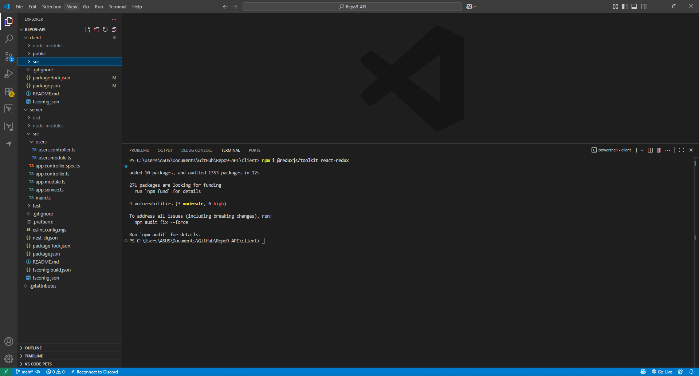

# Testing Redux with Jest

## Setup Redux Package



## Simple Redux Slice

```tsx
import { createSlice, PayloadAction, createAsyncThunk } from '@reduxjs/toolkit';

export interface CounterState {
  value: number;
}

const initialState: CounterState = { value: 0 };

// Simple async thunk (pretend API): resolves with the amount
export const incrementAsync = createAsyncThunk<number, number>(
  'counter/incrementAsync',
  async (amount: number) => {
    // Imagine an API call here. Keeping it simple & deterministic.
    return amount;
  }
);

const counterSlice = createSlice({
  name: 'counter',
  initialState,
  reducers: {
    increment(state) {
      state.value += 1;
    },
    decrement(state) {
      state.value -= 1;
    },
    incrementByAmount(state, action: PayloadAction<number>) {
      state.value += action.payload;
    },
    reset: () => initialState,
  },
  extraReducers: (builder) => {
    builder.addCase(incrementAsync.fulfilled, (state, action) => {
      state.value += action.payload;
    });
  },
});

export const { increment, decrement, incrementByAmount, reset } = counterSlice.actions;
export default counterSlice.reducer;

```

## A test for the Redux Slice (Reducer and Async)

```tsx
import counterReducer, {
  CounterState,
  increment,
  incrementByAmount,
  reset,
  incrementAsync,
} from './counterSlice';
import { configureStore } from '@reduxjs/toolkit';

describe('counter reducer (pure reducer tests)', () => {
  it('returns initial state by default', () => {
    expect(counterReducer(undefined, { type: '@@INIT' } as any)).toEqual({ value: 0 });
  });

  it('handles increment', () => {
    const start: CounterState = { value: 0 };
    expect(counterReducer(start, increment())).toEqual({ value: 1 });
  });

  it('handles incrementByAmount', () => {
    expect(counterReducer({ value: 10 }, incrementByAmount(5))).toEqual({ value: 15 });
  });

  it('handles reset', () => {
    expect(counterReducer({ value: 99 }, reset())).toEqual({ value: 0 });
  });
});

describe('counter async thunk (integration-style)', () => {
  it('adds payload when incrementAsync resolves', async () => {
    const store = configureStore({ reducer: { counter: counterReducer } });

    await store.dispatch(incrementAsync(7));

    const state = store.getState() as { counter: CounterState };
    expect(state.counter.value).toBe(7);
  });

  it('can be tested via fulfilled action directly (unit-style)', () => {
    const fulfilled = { type: incrementAsync.fulfilled.type, payload: 3 };
    expect(counterReducer({ value: 5 }, fulfilled)).toEqual({ value: 8 });
  });
});

```

## Run the Test


## Push to GitHub


## Reflection

## 1) Most Diff(async) Parts of Testing Redux

**Designing the Correct Test Granularity**

Problem: Determining what should be put into unit tests (reducers, selectors) versus integration tests (slice + store + thunk) versus UI tests (connected components).

Solution: Keep reducers/selectors as strict unit tests; test thunks against real store (at least) or mocked dependencies; leave DOM issues to component tests.

**Async Thunks & Side-Effects**

Problem: API/timer thunks are unreliable unless awaited or isolated; dispatched actions order is important.

Workaround: Utilize async/await and assert on last state; mock network requests (e.g., global.fetch or MSW); check order with toEqual on store.getActions() when using a mock store.

**State Shape & Immutability**

Problem: State mutations without warning render assertions unstable and cause cross-test leakage.

Mitigation: Use Redux Toolkit (Immer) for immutable updates where possible; in test scenarios, treat state as read-only and match by deep equality where necessary.

**Middleware & Store Configuration**

Problem: Middleware (thunk, logger, custom) can influence action flow and timing; omitted middleware causes async tests to fail.

Mitigation: Set up a minimal configureStore({ reducer, middleware }) per test suite; only include the tested middleware.

**Testing Selectors with Derived/Normalized Data**

Challenge: Selectors that return many slices or utilize memoization may be difficult to configure.

Mitigation: Unit test selectors with tiny fixture states; in memoized selectors, call twice and assert referential stability when inputs do not change.

**Error & Edge-Case Coverage**

Challenge: Making sure error branches in reducers/thunks (e.g., rejected actions) are hit.

Mitigation: Pass thunk.rejected and thunk.fulfilled actions directly, or mock the dependency to induce failures/successes.

---

## 2) How Redux Tests Differ from React Component Tests

**Subject Under Test**

Redux: Basic logic and state transitions (reducers, selectors, action creators, thunks).

React Components: UI behavior and accessibility (rendered text/roles, focus, events).

**Assertions**

Redux: Announce state snapshots and action sequences (e.g., { value: 7 } after actions).

React: Announce DOM outcomes with React Testing Library (getByRole, findByText), not internal state.

**Test Tools & Queries**

Redux: Pre-stock Jest with @reduxjs/toolkit's configureStore, optional mock stores; minimal or zero DOM.

React: RTL + @testing-library/user-event to test user-like interactions.

**Mocking**

Redux: Mock thunks' dependencies (API clients, timers); check dispatched action order periodically.

React: Mock network at the edge (e.g., fetch/MSW) and maintain component tests on user-visible behavior.

**Asynchrony Handling**

Redux: Wait for thunk dispatches and check final state or dispatched actions.

React: Wait for UI updates (findBy*, waitFor, waitForElementToBeRemoved) after interactions.

**Redux:** Tests are stable when state contract and action semantics aren't altered.

**React:** Tests are stable when user-facing behavior/markup semantics (roles/labels/text) aren't altered, no matter component internals.

**Scope**

Redux: Unit tests can be headless/DOM-free in total; integration tests can boot up a minimal store.

React: Always render components; use providers only if the component is dependent on the store/context.